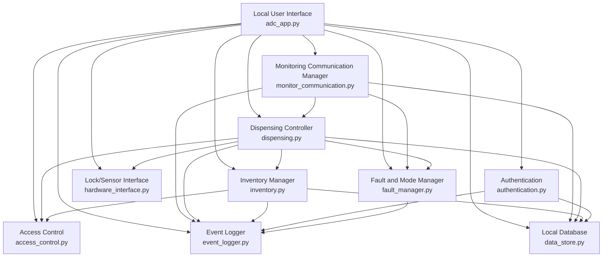

# Modular Decomposition - Part A (Automated Dispensing Cabinet)

This is the **module guide** for Part A. It follows Parnas's information-hiding principle: identify likely changes, assign each change to a single owning module (its *secret*), expose a stable interface, and ensure dependencies form a USES hierarchy. The code-level interfaces are in [modular-design-and-interfaces.md](modular-design-and-interfaces.md).

## 1. Anticipated changes

The table describes the intended design boundary. Actual file/class names are those in the provided `ADC_Project_D2/` Python prototype; proposed hardening is called out explicitly.

| ID | Anticipated change (secret) | Hidden by | Current code |
| --- | --- | --- | --- |
| AC-A-01 | How a clinician interacts with the ADC (CLI today; GUI/keypad later), prompts and screen formatting | Local User Interface | `adc_app.py` (`ADCApplication`) |
| AC-A-02 | Password hashing, authentication procedure, failed-attempt threshold, lockout duration | Authentication | `authentication.py`; hash helpers in `data_store.py` |
| AC-A-03 | Level-to-operation and medication/quantity permission rules | Access Control | `access_control.py` |
| AC-A-04 | Medication record, quantity, location and unavailable-state policies; 20-unit capacity | Inventory Manager | `inventory.py` |
| AC-A-05 | Dispense lifecycle, one request/one completion, withdrawal windows and grouped policy calculations | Dispensing Controller | `dispensing.py` |
| AC-A-06 | Fault classification, trigger/clear rules and Normal/Maintenance/Fault transition policy | Fault and Mode Manager | `fault_manager.py` (one class owns both in this demo) |
| AC-A-07 | Real lock/door sensor technology versus simulated hardware, command and feedback semantics | Lock/Sensor Interface | `hardware_interface.py` |
| AC-A-08 | ADC ↔ Monitoring wire protocol, address, retry, message encoding, command validation and acknowledgements | Monitoring Communication Manager | `monitor_communication.py` |
| AC-A-09 | Local event/fault record representation, capacities, acknowledgement and clearing | Event Logger | `event_logger.py` |
| AC-A-10 | Storage engine, user/medication/policy/identity persistence and lookup representation | Local Database | `data_store.py` |

`models.py` is **shared vocabulary**, not a leaf module with independent policy: it contains `Mode`, `Severity`, `User`, `Medication`, `WithdrawalPolicy`, `Fault`, `Event`, ID generation and timestamp helpers. The demo uses `datetime` directly in multiple modules; a replaceable Clock would be valuable for accurate timed tests, but **no Clock module currently exists**. It is not shown as implemented.

### Unlikely changes / baseline constraints

| ID | Baseline item | Why shared knowledge is acceptable |
| --- | --- | --- |
| UC-A-01 | D1 has exactly three authorization levels | FR-AUTH-07 fixes the level set; the *permissions* themselves remain hidden in Access Control |
| UC-A-02 | Five containers, 20 medication units maximum each | D1 A-01/A-02; explicit prototype constraints |
| UC-A-03 | Four fault severities INFO, WARNING, ERROR, CRITICAL | FR-FAULT-06 fixes this vocabulary |
| UC-A-04 | Medication quantities are entered/confirmed manually | D1 A-03 fixes absence of a counting sensor |
| UC-A-05 | The ADC alone must decide whether its physical lock may open | FR-COM-07 and NFR-SAF-08 prevent the external system from bypassing safety |

The **external JSON/HTTPS schema and UUID v4 identifier format are not placed in this fixed list**: although Part B's D2 documentation proposes them, its referenced common interface contract was not uploaded, and the current Part A prototype differs. Until reconciled, the boundary's protocol is an anticipated change hidden by the communication adapter.

## 2. Module hierarchy

The hierarchy is conceptual; only the leaf modules below are mapped to Python files. Modules are **not** identical to the D1 domain entities/classes. The Local Database, user interface, Lock/Sensor Interface and Monitoring Communication Manager hide implementation details not necessarily visible as domain classes.

| ID | Module | Category | Responsibility | Secret |
| --- | --- | --- | --- | --- |
| 1 | Automated Dispensing Cabinet | System | Safe cabinet access and audit | All secrets below |
| 1.1 | Boundary adapters | Conceptual | Convert environment/user/partner signals to software inputs/outputs | Hardware and presentation choices |
| 1.1.1 | Local User Interface | Hardware/interface hiding | Capture credentials/requests and show outcomes | AC-A-01 |
| 1.1.2 | Lock/Sensor Interface | Hardware hiding | Simulate/replace lock and door operations | AC-A-07 |
| 1.1.3 | Monitoring Communication Manager | Interface hiding | Translate, validate and transmit external messages | AC-A-08 |
| 1.2 | Required behaviour | Conceptual | Enforce D1 functional/safety rules | Behaviour that may evolve |
| 1.2.1 | Authentication | Behaviour hiding | Individual logins, passwords, lockout | AC-A-02 |
| 1.2.2 | Access Control | Behaviour hiding | Level and medication permissions | AC-A-03 |
| 1.2.3 | Inventory Manager | Behaviour hiding | Stock, records, locations, availability | AC-A-04 |
| 1.2.4 | Dispensing Controller | Behaviour hiding | Safe dispense and policy groups | AC-A-05 |
| 1.2.5 | Fault and Mode Manager | Behaviour hiding | Classification, lockdown, recovery, mode changes | AC-A-06 |
| 1.3 | Stored-state decisions | Conceptual | Store/retain auditable, restart-sensitive state | Storage choices |
| 1.3.1 | Event Logger | Software decision hiding | Capacity, event/fault records, ack, clearing | AC-A-09 |
| 1.3.2 | Local Database | Software decision hiding | User, medication, policy, request/command IDs | AC-A-10 |

**Classification note:** Part B classifies its monitoring link as a hardware-hiding module; Part A's communications module is likewise a boundary-hiding adapter. In this prototype, the UI is a command-line process and lock hardware is a simulation. This describes a replaceable boundary, not an assertion that physical hardware has been integrated.

## 3. USES hierarchy

A → B means module A **USES** module B through the operations documented in [modular-design-and-interfaces.md](modular-design-and-interfaces.md). The graph is directed and acyclic; it follows the Python constructor dependency flow or method arguments. `models.py` (shared types) is omitted because importing shared types is not an architectural USES dependency.

**Why no cycle:** the communication adapter may call the dispensing controller to ask for a *locally checked* operation, but the dispensing controller does not call the communication adapter. Event Logger and Local Database are lower-level services that do not call back into domain policy; the CLI composes the system at the top. This is the architecture of the current code, although some cross-module state is publicly exposed and should be hardened as noted below.

## 4. Design review test

| Anticipated change | Desired edit scope | Observed limitation / next action |
| --- | --- | --- |
| Replace simulated drawer with real actuator/sensors | Only `hardware_interface.py` adapter and its tests | Existing `unlock()` and `close_drawer()` are synchronous Boolean simulations; need real sensor feedback/timeout specification |
| Replace CLI with touchscreen UI | Primarily `adc_app.py` | Current CLI also handles inactivity and some presentation-driven control flow; move session timer to Authentication boundary before UI replacement |
| Change password hashing / account storage | Authentication / Local Database | `data_store.py` contains both storage and password-hash helpers; move hashing into Authentication to preserve single ownership |
| Change policy-window calculation | `dispensing.py` only | Currently uses direct wall-clock `datetime` and in-memory withdrawal list; inject a clock for determinism |
| Add real Monitoring HTTP interface | `monitor_communication.py` adapter; startup wiring | A live HTTP server, registration, validated partner messages and contract reconciliation are **not implemented** |
| Persist audit and inventory across restart | Event Logger and Local Database | Existing stores are in memory; changing persistence affects both, and a common transaction boundary is needed for stock+audit atomicity |
| Change fault recovery rule | `fault_manager.py` | CLI currently calls `resolve_condition()` without independent physical verification; strengthen fault-clear precondition |

The most consequential design violations to fix are **shared mutable storage exposed directly** (`store.users`, `store.medications`), **stock change before audit commit**, and **UI timing/command handling leaking safety policy**. The guide documents the intended hiding boundary and explicitly states the current prototype's limits; it does not label them fully encapsulated.
