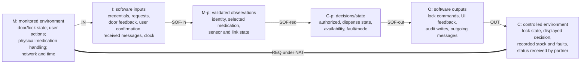

# Precise Specification - Part A (Automated Dispensing Cabinet)

## 1. Purpose and conventions

This document refines Part A Deliverable 1 into **unambiguous required behaviour**. It uses the four-variable model (Parnas/Madey) **once** to frame the ADC boundary, then gives black-box required relations (`SPEC-…`) by D1 function area. Five safety-critical groupings receive additional preconditions, postconditions and state invariants in [safety-critical-specifications.md](safety-critical-specifications.md). Requirements not addressed by a function table remain binding **as stated in D1**.

- **D1 identifiers are unchanged.** `SPEC-AUTH-…`, `SPEC-INV-…`, `SPEC-DISP-…`, `SPEC-LOG-…`, `SPEC-FAULT-…`, `SPEC-MODE-…`, and `SPEC-COM-…` are new *design specification* identifiers, not new D1 requirements.
- Function-table conditions are designed to be mutually exclusive and collectively exhaustive over the stated domain. A table row describes an observable decision or state change, **not implementation pseudocode**.
- Notation: `m_` = monitored environment; `c_` = controlled environment; `i_` = software input; `o_` = software output; `t` = current time; `q` = requested quantity; `qa` = user-confirmed actual quantity; `⊥` = absent/unknown; `x'` = value after the operation; `∧` AND; `∨` OR; `¬` NOT; `⇒` implication.
- At every **safety decision**, unknown/unavailable safety evidence counts as **not satisfied**. An Error/Critical fault is **blocking**. The special Level 2/3 fault-clear path is distinct from normal dispensing access.
- All limits and thresholds are from D1 unless explicitly labelled a **D2 design decision**. The five critical contracts are required behaviour, even where the demonstration program is only partial.

## 2. The four-variable model of the ADC

### 2.1 System boundary

The **environment** includes people at the cabinet, medication physically stored in drawers, the physical locks and door sensors, passage of time, and the hospital network/Monitoring System. Software sees these indirectly through the user interface, hardware adapter, clock and communication interface, and controls them using interface outputs. The Monitoring System cannot command a physical unlock directly: the ADC independently enforces the local conditions (FR-COM-07; NFR-SAF-08).

`M-p` and `C-p` represent useful software-side abstractions, **not** extra independent real-world variables. The design maps `SOF-in` to `ADCApplication`, `HardwareInterface`, `Authentication` and `MonitorCommunication`; `SOF-req` to `AccessControl`, `InventoryManager`, `DispensingController` and `FaultManager`; and `SOF-out` to the hardware/UI/communication adapters and event storage.

### 2.2 Monitored variables (M)

| Variable | Meaning | Values / range |
| --- | --- | --- |
| `m_identity(u)` | Identity established from an individual account and credentials entered at cabinet | User identifier or `⊥` |
| `m_request` | User's intended protected operation | Login, dispense, replenish, correct, configure, clear, maintenance, log view |
| `m_requestedMedication` | Medication selected for a dispense | Medication ID or `⊥` |
| `m_requestedQty` | Quantity selected for dispensing | Integer (valid only if `> 0`) |
| `m_actualWithdrawn` | Quantity the user confirms having removed | Integer `≥ 0`, or `⊥` when unconfirmed; **not sensed** (A-03) |
| `m_door(loc)` | Real drawer/door state | Open, closed, unknown |
| `m_lock(loc)` | Real lock/actuator feedback | Locked, unlocked, failed, unknown |
| `m_time` | Current time and elapsed inactivity/door-open duration | Timestamp, duration in seconds |
| `m_monitorLink` | Monitoring System reachability | Available, unavailable, unknown |
| `m_monitorCommand` | Command, configuration or acknowledgement from Monitoring System | Message with identity and authorization fields, or `⊥` |

Patient and medication information physically printed on a package is **not** machine-read by this prototype; the system relies on its stored medication record and user input.

### 2.3 Controlled variables (C)

| Variable | Meaning | Values / range |
| --- | --- | --- |
| `c_lock(loc)` | Physical access state under ADC command | Locked/unlocked or an error if hardware does not obey |
| `c_accessDecision` | User-facing permission to conduct a protected operation | Permit, reject(reason), pending-confirmation |
| `c_recordedQty(med)` | Quantity recorded by ADC after authorized workflow | Integer `0..20` |
| `c_availability(med)` | Whether ADC permits dispensing this record | Available/unavailable |
| `c_mode` | Operating mode visible/controlled by ADC | Normal, Maintenance, Fault |
| `c_faultDisplay` | Visible warning, lockdown message and required recovery level | Severity/type/message, or none |
| `c_auditState` | Local event and fault records, acknowledgements and synchronization status | Records and ack flags |
| `c_partnerOutput` | Status, inventory and activity communicated to Monitoring System | Protocol messages or pending queue |

### 2.4 Software inputs (I) and the IN relation

| Input | Source | Represents |
| --- | --- | --- |
| `i_credentials` | Login form/CLI | `m_identity` evidence; not identity until verified |
| `i_action`, `i_medicationId`, `i_requestedQty` | Local UI | `m_request`, `m_requestedMedication`, `m_requestedQty` |
| `i_confirmedQty` | Local UI after medication handling | `m_actualWithdrawn`; `⊥` if no confirmation |
| `i_doorFeedback`, `i_lockFeedback` | Lock/Sensor Interface | `m_door`, `m_lock`; unknown if sensor/adapter unavailable |
| `i_tick` | Clock | `m_time` |
| `i_linkStatus`, `i_message` | Monitoring Communication Manager | `m_monitorLink`, `m_monitorCommand` |

**IN:** valid sensor feedback represents the reported physical lock/door state; a user-entered confirmed quantity represents their statement of removal, **not independent physical verification**. A command marked as coming from the Monitoring System is not considered authenticated until its source/authorization are validated (NFR-SEC-09).

### 2.5 Software outputs (O) and the OUT relation

| Output | Receiver | Realizes |
| --- | --- | --- |
| `o_unlock(loc)`, `o_lock(loc)` | Lock/Sensor Interface | `c_lock(loc)` when hardware successfully executes command |
| `o_result`, `o_warning`, `o_countdown`, `o_faultScreen` | Local UI | `c_accessDecision`, `c_faultDisplay` |
| `o_inventoryCommit`, `o_availabilityCommit` | Storage module | `c_recordedQty`, `c_availability` |
| `o_eventCommit`, `o_faultCommit`, `o_ackCommit` | Event Logger / local storage | `c_auditState` |
| `o_status`, `o_transactions`, `o_commandOutcome` | Monitoring System adapter | `c_partnerOutput` |

**OUT:** issuing `o_unlock` alone does not prove physical unlocking. The ADC must inspect lock feedback; failed/unknown outcomes are fault conditions. Likewise, writing a quantity is a change of the **software record**, not an automatic physical count.

### 2.6 NAT: constraints of the environment

| NAT ID | Environment assumption/constraint | D1 source |
| --- | --- | --- |
| NAT-ADC-01 | Prototype has five physical storage locations; a location holds at most 20 units. | A-01, A-02 |
| NAT-ADC-02 | Quantity is manually confirmed by the user; no automatic counting sensor exists. | A-03 |
| NAT-ADC-03 | Lock and door feedback represent the physical hardware; a command can fail or a door can remain open. | A-04, FR-FAULT-01/02 |
| NAT-ADC-04 | An allowed door-close timeout exists; D1 *proposes*, but does not finalize, a 10-second default. | A-05 |
| NAT-ADC-05 | Users have individual credentials, and only Level 2/3 staff can configure medication/policy groups. | A-07, A-09 |
| NAT-ADC-06 | Cabinet has a unique ID and room/wing location; record timestamps use the configured local time zone. | A-10, A-11 |
| NAT-ADC-07 | D1 status communication period is 30 seconds when connected. | A-14, FR-COM-02 |
| NAT-ADC-08 | Partner's provided D2 documents additionally expect HTTPS registration/heartbeats, UUID v4 IDs, synchronized time and per-transaction acks. This is **partner-side documentation**, pending verification against the missing shared contract file. | Part B D2 `modular-design-and-interfaces.md` §4 and `assumptions-and-decisions.md` |

## 3. Required behaviour (REQ)

### 3.1 Authentication and access (AUTH)

**SPEC-AUTH-01 — Login and lockout.** Refines FR-AUTH-01, FR-AUTH-06, FR-AUTH-07, FR-AUTH-11, FR-LOG-01, NFR-SEC-01/02/05, NFR-PERF-01.

| Condition at submission | `c_accessDecision'` / session | Other required effects |
| --- | --- | --- |
| Login blocked (`now < lockUntil` or authorized manual clear still required) | Reject; no session created | Preserve failed-attempt/lockout state; record attempted login where possible |
| Not blocked and credentials valid | Grant; active session for exactly that user and level | Reset consecutive failures; record success; respond within 3 s |
| Not blocked and credentials invalid, threshold not reached | Reject; no session | Increment failures and record failure |
| Not blocked and credentials invalid, threshold reached | Reject; no session; enter lockout | Block further logins; record failure and lockout |

Only Level 3 changes lockout threshold/duration. Manual clearing requires Level 2/3. Password updates satisfy length `≥ 8`, digits `≥ 3`, special characters `≥ 3` (FR-AUTH-11).

**SPEC-AUTH-02 — Protected-operation authorization.** Refines FR-AUTH-02/03/08/09/10, NFR-SEC-03/04/07/08, NFR-USA-01.

| Session valid? | Operation and medication permissions sufficient? | Required result |
| --- | --- | --- |
| No | — | Deny; no protected state change; no patient information exposed |
| Yes | No | Deny; display required level or medication-specific permission, never password information |
| Yes | Yes | Permit **only** if that operation's additional safety preconditions also hold |

**SPEC-AUTH-03 — Inactivity.** Refines FR-AUTH-04/05, FR-FAULT-09, NFR-SEC-06, NFR-PERF-05, NFR-SAF-07, NFR-USA-02.

| Idle/session condition | Required session/lock behaviour |
| --- | --- |
| Active and idle `< 15 s` | Session remains active; no countdown |
| Active and idle `≥ 15 s` with countdown not expired | Show countdown; new input cancels it; countdown configurable by Level 3 in `[1,900] s` |
| Countdown reaches zero and door closed | Expire session; protected operations denied until re-authentication |
| Countdown reaches zero while door open | Expire session; door remains physically closable without re-authentication; after closure enter Error lockdown |

### 3.2 Medication inventory (INV)

**SPEC-INV-01 — Quantity/location integrity.** Refines FR-INV-01–05, FR-INV-07, FR-INV-11, NFR-REL-01/02/03.

| Change request | Required result |
| --- | --- |
| New record from Level 2/3; free location, all required fields, confirmed `0 ≤ q ≤ 20`; fewer than five occupied locations | Create unique stable medication ID and one active record at exactly one location; log result |
| New record otherwise | Reject; no record/location/quantity change |
| Replenishment by Level 2/3 with confirmed added quantity `a > 0` and `q + a ≤ 20` | Set `q' = q + a`; create matching audit record |
| Replenishment otherwise | Reject the **entire** addition; `q' = q` (FR-INV-11) |
| Correction by Level 2/3 with confirmed `0 ≤ qc ≤ 20` | Set `q' = qc`; record previous/resulting quantity, user, timestamp |
| Correction otherwise | Reject; quantity and availability unchanged |

**SPEC-INV-02 — Uncertain inventory and completed withdrawal.** Refines FR-INV-06/08/09, FR-DISP-06, NFR-SAF-04, NFR-REL-03.

| Condition | Required result |
| --- | --- |
| Confirmed completed dispense with actual withdrawn `qa` valid | `q' = q - qa` and matching audit outcome; update last-access user/time |
| Quantity incorrect or not confirmable | Set unavailable; reject subsequent dispensing until Level 2/3 correction or confirmation |
| Level 2/3 confirms/corrects an uncertain record | Permit availability restoration only after successful audit/quantity reconciliation |
| Unauthorized user requests patient/medication details | Do not disclose protected information |

**SPEC-INV-03 — Low stock.** Refines FR-FAULT-12, FR-FAULT-08. For initial confirmed loaded quantity `q0`, after a resulting quantity `q ≤ 0.10 × q0`, a Warning is displayed and recorded, and transmitted when connected; this warning alone does not stop Normal Mode.

FR-INV-10 is **optional** in D1 (restart persistence). Its omission does not remove the safety obligation to refuse operations when required state cannot be trusted.

### 3.3 Dispensing (DISP)

**SPEC-DISP-01 — Local gate before unlock.** Refines FR-DISP-01–04/08, NFR-SAF-01/02, FR-LOG-12.

Define `safeDispense(r) := validActiveSession ∧ medicationPermission ∧ available ∧ (requestedQty > 0) ∧ (requestedQty ≤ recordedQty) ∧ policyAllows ∧ (mode = Normal) ∧ ¬blockingFault ∧ knownSafeLocation ∧ auditWritable ∧ requestNotCompleted`.

| `safeDispense(r)` | `c_accessDecision'` | `c_lock'` |
| --- | --- | --- |
| True | Accept request, pending physical access and later user confirmation | Unlock **only** `location(medicationId)` |
| False | Reject with appropriate reason; record refusal where required | No new unlock command; inventory unchanged |

**SPEC-DISP-02 — Completion.** Refines FR-DISP-06, FR-INV-06, FR-LOG-02, NFR-REL-03.

| Physical operation and confirmation | Required outcome |
| --- | --- |
| Successful authorized access; user explicitly confirms valid actual withdrawn quantity; safe drawer closure and audit commit succeed | One completed dispense; reduce quantity by **confirmed actual** amount; record same resulting quantity/outcome |
| Confirmation missing or invalid | Not completed; do not falsely claim inventory reconciliation; mark uncertain/unavailable if physical quantity cannot be established |
| Hardware unlock or closure fails | No successful completion; raise an appropriate blocking fault and enter Fault Mode |

**SPEC-DISP-03 — Policy windows and grouped limits.** Refines FR-DISP-07–12, NFR-SAF-05, NFR-USA-03.

Let `used(group,t)` be the sum of confirmed quantities from all records in the manually configured group whose withdrawal timestamps fall in the active window. `remaining = max(0, limit(group) − used(group,t))`.

| Request compared with active group history | Required result |
| --- | --- |
| Requested quantity exceeds remaining allowance | Reject and log |
| Within allowance, no prior withdrawal in window | Continue to other safety checks |
| Within allowance, prior withdrawal in window, repeat not confirmed | Show prior time/quantity, remaining allowance, reset time; wait for intentional-repeat confirmation |
| Within allowance, repeat confirmed | Continue to other safety checks |

Only Level 2/3 configures policies/groups. A Level 2/3 inventory-workflow removal override is **explicitly selected and logged**, not a hidden bypass of the normal Level 1 dispense limit.

**SPEC-DISP-04 — Duplicate request ID.** Refines FR-DISP-05, NFR-SAF-03, NFR-REL-06.

| Request ID state | Required result |
| --- | --- |
| Already completed | Reject/no re-execution; no unlock, quantity change or new completed dispense |
| New and usable | May proceed through all other checks; mark completed **at most once** after confirmed outcome |
| Processing/unknown after interruption | Do not cause a second physical dispense; hold for safe reconciliation if prior outcome cannot be established |

### 3.4 Audit records and faults (LOG/FAULT)

**SPEC-LOG-01 — Required audit before protected action.** Refines FR-LOG-01–07/12, NFR-AUD-01/02/07.

| Required audit record can be committed? | Operation effect |
| --- | --- |
| Yes | Create attributable record with appropriate IDs, user/source, timestamp, action and outcome; any inventory-changing operation and matching record form one logical commit |
| No | Reject protected operation **before** performing an unaudited change, with no unlock or inventory mutation |

**SPEC-LOG-02 — Capacity, acknowledgement and clearing.** Refines FR-LOG-08–11, NFR-AUD-04–06, NFR-REL-05.

| Condition | Required result |
| --- | --- |
| New event/fault record and capacity available | Store unique record ID and unacknowledged state; capacities at least 500 event and 100 fault records |
| Storage full with unacknowledged records | Preserve those records; never overwrite them |
| Authenticated Level 3 requests clear of records all acknowledged | Clear eligible records and create attributable log-clear event |
| Unacknowledged records or insufficient permission | Do not clear those records |

**SPEC-FAULT-01 — Classify and enter safe mode.** Refines FR-FAULT-01–03/06–08/10–12, FR-MODE-02/05, NFR-PERF-02.

| Condition detected | Required mode/access result |
| --- | --- |
| INFO or WARNING and no blocking fault | Remain Normal; display/record; forward warnings when connected |
| ERROR or CRITICAL | Enter Fault within **3 s**; stop normal medication access; lock where possible; report and record fault |
| Safety state indeterminable, authorization data corrupt/unavailable or required inventory unusable | Raise **Critical** and enter Fault within **3 s** |

**SPEC-FAULT-02 — Authorized recovery.** Refines FR-FAULT-04/05, NFR-REL-04, NFR-SAF-06.

| Fault condition and authorization | Required result |
| --- | --- |
| Cause still present or cannot be proved resolved | Deny clear; fault remains active |
| Cause resolved, Error, authenticated Level 2/3 | Clear Error; reevaluate active faults and mode; audit responsible user/time |
| Cause resolved, Critical, authenticated Level 3 | Clear Critical; reevaluate active faults and mode; audit responsible user/time |
| Any other clear request | Deny; retain fault and lockdown |

**SPEC-FAULT-03 — Door still open at session expiry.** Refines FR-AUTH-05, FR-FAULT-09, NFR-SAF-07. An already-open door remains physically closable without authentication. It must not newly unlock. When it closes after an expired session, the ADC enters Error Fault Mode and requires Level 2/3 clearance.

### 3.5 Modes (MODE)

**SPEC-MODE-01 — Mode restrictions.** Refines FR-MODE-01/03–07.

| Active mode / request | Required result |
| --- | --- |
| Normal; permitted user action | Apply the applicable local operation specification |
| Normal; Level 3 explicitly requests maintenance, with no blocking fault | Enter Maintenance; expose permitted tests/settings/log functions |
| Maintenance; normal dispense requested | Reject; normal medication dispensing is disabled |
| Fault; normal login/medication operation requested | Reject; retain restricted fault-clear login and fault display |
| Fault; all blocking faults resolved and cleared, state safe | Return Normal; otherwise stay Fault |

FR-MODE-08/09 (restart/sleep/shutdown and restore state) are **optional** in D1.

### 3.6 ADC / Monitoring System communication (COM)

**SPEC-COM-01 — Status and inventory transmission.** Refines FR-COM-01–04/14/15, NFR-PERF-03. While connected, send status at **30 s** intervals with unique cabinet ID, configured location, occupied/empty location counts, active faults and log/synchronization status. Transmit authorized detailed inventory according to the agreed interface. Part B's supplied D2 additionally expects register/heartbeat messages; exact schema remains subject to the referenced but unprovided interface contract.

**SPEC-COM-02 — Transaction retry and acknowledgement.** Refines FR-COM-03/11–13, NFR-REL-05/06, NFR-PERF-04.

| Transmission / acknowledgement | Required local record state |
| --- | --- |
| New required event/fault, no valid record acknowledgement | Retain with stable ID as **unacknowledged**; eligible for retry on subsequent cycles |
| Transport failure or Monitoring System unavailable | Retain records locally; record/display appropriate communication warning |
| Valid acknowledgement naming this exact record ID | May mark record acknowledged; do not generate a duplicate logical event |
| Link recovers | Resume periodic status and resend pending records without requiring ADC restart |

**SPEC-COM-03 — Remote request validation and unlock.** Refines FR-COM-05–08/13, NFR-SAF-08, NFR-SEC-09/10, NFR-REL-06/07.

| Command condition | Required outcome |
| --- | --- |
| Source/format/ID/authorization invalid; duplicate command; or unsupported command | Reject **before protected state change**, and return attributable failure if possible |
| Valid command but local dispensing/safety checks fail | Reject; no physical unlock; return actual result with same command ID |
| Valid remote access command and all local checks pass | May authorize **only** corresponding location access; never equate remote authorization with physical quantity confirmation; report actual result and command ID |

**SPEC-COM-04 — Communication outage.** Refines FR-COM-09/10, NFR-SAF-09, NFR-AVA-01/02/03. A Monitoring System outage creates a warning and queues unacknowledged records; **local operations continue only when all local authentication, inventory, policy, fault and audit checks pass**. A communication failure alone is not a reason to bypass any local safety condition.

## 4. Gaps found when refining D1

These are **design/implementation clarifications for review**, not silently adopted new D1 requirements.

| Issue | Source | Safe interpretation / team action |
| --- | --- | --- |
| When does confirmation occur relative to hardware access? | FR-DISP-06, A-03 | Confirm **actual amount after handling**, not before unlocking. Current CLI differs. |
| What if a physical dispense occurred but the user leaves without confirming? | FR-INV-08, FR-DISP-06, NFR-SAF-04 | Do not declare complete or assume physical quantity; mark medication unavailable for authorized reconciliation. |
| What happens if inventory is changed but audit write fails? | FR-LOG-12, NFR-REL-03 | Reject before mutation or commit stock and audit atomically. Current implementation can mutate first. |
| Does a remote unlock imply a remote dispense? | FR-COM-07, FR-DISP-06, NFR-SAF-08 | **No**; access permission and physical withdrawal confirmation are distinct. Current remote demo auto-confirms. |
| What if the lock/sensor state is unknown? | FR-FAULT-11 | Treat inability to prove safe state as Critical rather than guessing. |
| Which commands are supported over HTTP and what is their schema? | FR-COM-05–08; Part B D2 docs | Part B describes maintenance/configuration endpoints; Part A demo exposes a different synthetic `REMOTE_UNLOCK` handler. Obtain shared contract and reconcile. |
| Are IDs stable across restarts and UUID v4? | Part B D2 interface assumptions A-21/A-22/A-26 | Part A current IDs/seed IDs are not UUID v4 and state resets. Resolve prior to integration test. |
| Door-close fault duration | D1 A-05 | D1 proposes 10 s but explicitly says value to be agreed; do not present as settled. |

## 5. Traceability: D1 → SPEC

The complete individual requirement mapping is in [traceability.md](traceability.md). The five detailed critical contracts are in [safety-critical-specifications.md](safety-critical-specifications.md). Requirement-to-code mapping uses the exact Python source files in `ADC_Project_D2/`.

### Requirements involving several modules

A module is assigned as the **decision owner**; a module acting through its public interface to enforce or record that decision can also appear where the behaviour genuinely spans modules. Examples:

- Authorization rules are decided by `AccessControl`/`Authentication`; the CLI presents a denial and the Event Logger records the result.
- Dispensing sequence and completed request ID are owned by `DispensingController`; the hardware adapter only commands the selected location, and inventory storage changes only after authorized confirmation.
- Fault classification/recovery is owned by `FaultManager`; it uses `EventLogger` and the hardware adapter supplies sensor outcomes.
- Wire protocol/transaction retry is owned by `MonitorCommunication`; it never determines locally whether a medication may be dispensed.

See [modular-decomposition.md](modular-decomposition.md) for the information-hiding rationale and [modular-design-and-interfaces.md](modular-design-and-interfaces.md) for the exported operations.
