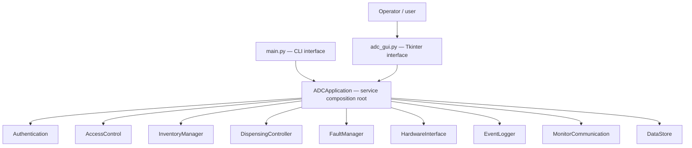

# Deliverable 2 Design Update: Desktop User Interface

This file supplements the existing Part A D2 Markdown design documentation. The desktop GUI was developed **after** the original CLI-based Deliverable 2 modular design was prepared. Update any submitted diagrams/tables that identify the terminal as the only interface accordingly.

## New presentation module

| Property | Description |
|---|---|
| Module | Operator Interface (graphical presentation adapter) |
| Anticipated change hidden | Interface technology and layout may change from terminal menus to a touchscreen, browser, or kiosk without changing the safety-critical backend |
| Class and file | `ADCDesktopApp`, `adc_gui.py` |
| GUI entry point | `gui_main.py` imports `launch_gui()` |
| GUI technology | Python standard-library Tkinter / ttk |
| State | Current selected page, form values, session UI timer, visual feedback; core medication and fault state is **not copied** into a new GUI database |
| Uses | `ADCApplication` as composition root; indirectly `Authentication`, `InventoryManager`, `DispensingController`, `FaultManager`, `HardwareInterface`, `EventLogger` and `MonitorCommunication` |
| Used by | End users and the demo launcher; no business-logic module imports `adc_gui.py` |
| UI requirements | Readable labels, explicit error messages, role-sensitive controls, visible fault/network/mode state, visible inactivity countdown |

The module's **secret** is presentation: screen arrangement, widget technology, form layout, page transitions, colors and labels. Its exported operation is `launch_gui()`; it creates the root UI and runs Tkinter's event loop. Most backend interaction is through the preexisting service interfaces. `ADCApplication` is reused to wire all services; its blocking `run()` terminal loop is never called.

### Dependency direction

No backward dependency on Tkinter is introduced into the safety-critical backend. `python main.py` and `python gui_main.py` are alternative entry points for the **same** underlying services and module rules.

## Safety-critical UI interaction (example)

| Stage | User interface | Service method | What it guarantees |
|---|---|---|---|
| 1 | User requests quantity, clicks Validate and unlock | `DispensingController.start_dispense()` | Checks mode, role, medication permission, inventory, policy, request ID and audit capacity before simulated unlocking |
| 2 | User clicks Close simulated drawer | `DispensingController.close_dispense_drawer()` | Successful close sets pending state closed; failed close raises Error and quarantines stock |
| 3 | User enters actual quantity and clicks Confirm | `DispensingController.complete_dispense()` | Updates stock by confirmed quantity, finalizes reserved audit event and completed request ID |
| Aborted | User cancels or session expires | `DispensingController.cancel_dispense()` | Attempts closure and quarantines uncertain stock |

The GUI also runs `MonitorCommunication.status_cycle()` every 30 seconds while the process is active (instead of requiring a manual terminal menu choice). This **is not a network heartbeat**: the underlying transport and acknowledgement handling remain simulated.

## Module interfaces affected

The backend methods and their preconditions/postconditions are unchanged. Added **UI interactions** translate forms and buttons into calls and show return values or exceptions. The GUI adds:

- A Tkinter `after()` timer that expires sessions asynchronously relative to ordinary UI interaction, while preserving the backend pending-dispense safety path. This timer does not independently monitor physical hardware.
- An administrative form to configure inactivity, with an audit record before configuration changes.
- Role-specific views (Audit Log L2+, Settings L3+, inventory mutations L2+); **these UI restrictions are supplementary**, not security boundaries.
- A demo-only simulated remote unlock action that still delegates to `MonitorCommunication.handle_command()` and `DispensingController.start_dispense()`.

## Requirements / verification impact

Representative related requirements: FR-AUTH-04/05 (inactivity), FR-DISP-01/02/05/06 (withdrawal request/safety/duplicate/confirmation), FR-FAULT-04/05/06 (fault clearance/mode), FR-MODE-01–07 (operating modes), FR-COM-02/07/08/10–12 (messages and queue), NFR-USA-01/02/05/06/07/08 (usability, messages and countdown). Their **implementation references should now include `adc_gui.py`** where presentation is relevant, alongside the original backend method.

`test_gui_integration.py` adds tests for protected navigation, the UI dispensing steps, uncertainty after cancellation, drawer-close fault recovery, Maintenance Mode, session expiry and simulated Monitoring acknowledgements. The existing 23 backend tests are unchanged.

## New limitations / honest claims

- A presentation layer helps demonstrability and provides an event-loop inactivity timer, but is **not independent hardware safety supervision**.
- A demo login page with quick-fill credentials, synthetic fault injection and synthetic repairs is **not fit for clinical deployment**.
- In-memory state, lack of live Part B connectivity and non-durable audit commits remain unchanged.
- A graphical UI does not automatically establish NFR security/privacy completeness; backend permissions are the enforcement layer and additional privacy controls are needed in a real system.
