# Activity Diagrams - Part B (Hospital Monitoring System)

Notation: rounded boxes are actions, labelled diamonds are decisions (their outgoing flows carry the guards), and empty diamonds are merges. No action has more than one incoming flow: alternative paths always meet in a merge, since several flows entering an action would be an implicit join. The scenarios have no concurrent paths, hence no fork or join bars.

## 1. Inventory Monitoring (Scenario 1)

```mermaid
%%{init: {"flowchart": {"wrappingWidth": 600, "rankSpacing": 28, "nodeSpacing": 30}}}%%
flowchart TD
    Start((" ")) --> Request("Pharmacist requests the inventory overview")
    Request --> Retrieve("Retrieve the inventory of each registered ADC<br/>and the aggregated quantity per medication<br/>(FR-INV-02, FR-INV-06)")
    Retrieve --> Fresh{"ADC status and inventory<br/>updated less than 45 s ago?"}
    Fresh -- "no" --> Stale("Label the ADC's data 'stale'<br/>with its last-update time<br/>(NFR-SAF-01)")
    Fresh -- "yes" --> M1{" "}
    Stale --> M1
    M1 --> Low{"Any medication with less than<br/>10 boxes in an ADC?<br/>(FR-INV-03)"}
    Low -- "no" --> ShowAll("Display the inventory without flag")
    Low -- "yes" --> Flag("Flag the ADC 'Low Stock' and show it<br/>on the dashboard's main view<br/>(FR-INV-03, NFR-USA-01)")
    Flag --> Search("Search the other ADCs of the same floor<br/>holding more than 10 boxes of the medication<br/>(FR-INV-04)")
    Search --> Found{"At least one<br/>ADC found?"}
    Found -- "yes" --> List("Display the list of those ADCs")
    Found -- "no" --> NoStock("Display 'no stock available'<br/>(FR-INV-05)")
    ShowAll --> M2{" "}
    List --> M2
    NoStock --> M2
    M2 --> End(((" ")))

    classDef initial fill:#000,stroke:#000;
    classDef final fill:#000,stroke:#000;
    class Start initial;
    class End final;
```

## 2. Alarm Reception and Acknowledgement (Scenario 2)

```mermaid
%%{init: {"flowchart": {"wrappingWidth": 600, "rankSpacing": 28, "nodeSpacing": 30}}}%%
flowchart TD
    Start((" ")) --> Receive("Receive a heartbeat containing an alarm transaction<br/>(sent immediately by the ADC when it raises the alarm)")
    Receive --> Registered{"Sending ADC<br/>registered?"}
    Registered -- "no" --> Discard("Discard the heartbeat and log it<br/>(NFR-SEC-03)")
    Discard --> EndA(((" ")))
    Registered -- "yes" --> Duplicate{"Transaction identifier<br/>already received?"}
    Duplicate -- "yes" --> Skip("Do not record it again<br/>(FR-COM-08)")
    Skip --> AckDup("Acknowledge the transaction as 'received'<br/>(FR-REQ-01)")
    AckDup --> EndB(((" ")))
    Duplicate -- "no" --> Complete{"ADC, timestamp, type and<br/>severity present, severity one of<br/>info / warning / error / critical?"}
    Complete -- "no" --> Reject("Reject the alarm and log it<br/>(FR-ALM-02, FR-ALM-03)")
    Reject --> AckRej("Acknowledge the transaction as 'rejected'<br/>(FR-REQ-01)")
    AckRej --> EndC(((" ")))
    Complete -- "yes" --> Record("Record the alarm with the ADC's timestamp,<br/>ADC, type and severity<br/>(FR-ALM-01)")
    Record --> AckOk("Acknowledge the transaction as 'received',<br/>after it is recorded (FR-REQ-01)")
    AckOk --> Display("Display the alarm within 2 s with a text<br/>severity label, a visual cue and an audible cue<br/>(FR-ALM-04, NFR-PRF-01, NFR-ACC-01, NFR-ACC-02)")
    Display --> UserAck("A user requests to acknowledge the alarm")
    UserAck --> Permitted{"User's role<br/>permitted?"}
    Permitted -- "no" --> Denied("Display a permission message<br/>(NFR-SEC-02)")
    Denied --> M
    Permitted -- "yes" --> Already{"Alarm already<br/>acknowledged?"}
    Already -- "yes" --> Inform("Show the requesting user which user<br/>acknowledged it (FR-ALM-06)")
    Already -- "no" --> Mark("Mark the alarm acknowledged with the user ID<br/>and log user, action, ADC and time<br/>(FR-ALM-05, NFR-AUD-01)")
    Inform --> M{" "}
    Mark --> M
    M --> EndD(((" ")))

    classDef initial fill:#000,stroke:#000;
    classDef final fill:#000,stroke:#000;
    class Start initial;
    class EndA,EndB,EndC,EndD final;
```

## 3. ADC Communication Failure (Scenario 3)

```mermaid
%%{init: {"flowchart": {"wrappingWidth": 600, "rankSpacing": 28, "nodeSpacing": 30}}}%%
flowchart TD
    Start((" ")) --> MWait{" "}
    MWait --> Wait("Wait for the next heartbeat<br/>of a registered ADC")
    Wait --> Within45{"Heartbeat received less than<br/>45 s after the previous one<br/>(or the registration, FR-HLT-06)?"}
    Within45 -- "yes" --> MRecord{" "}
    MRecord --> RecordHb("Record the heartbeat reception time<br/>(FR-COM-03)")
    RecordHb --> Store("Store the reported status, the complete inventory<br/>and the transactions not yet received,<br/>then acknowledge them<br/>(FR-COM-07, FR-COM-08, FR-INV-01, FR-REQ-01)")
    Store --> ShowState("Display the operational state<br/>reported by the ADC<br/>(FR-HLT-01)")
    ShowState --> MWait
    Within45 -- "no" --> Unreachable("Mark the ADC 'unreachable', label its status<br/>and inventory 'stale', record the status change<br/>(FR-HLT-02, NFR-SAF-01, NFR-SAF-03, FR-HIS-03)")
    Unreachable --> Within75{"Heartbeat received less than<br/>75 s after the previous one?"}
    Within75 -- "yes" --> MRecover{" "}
    MRecover --> Recover("Show the state reported in that heartbeat<br/>(FR-HLT-05)")
    Recover --> MRecord
    Within75 -- "no" --> Offline("Mark the ADC 'offline', regardless of its<br/>last reported state, record the status change<br/>(FR-HLT-03, NFR-SAF-03, FR-HIS-03)")
    Offline --> Alert("Raise a 'communication loss' alarm of severity 'error',<br/>displayed within 2 s and handled like any alarm;<br/>it stays unacknowledged even if the ADC comes back<br/>(FR-HLT-04, FR-HLT-07, NFR-PRF-01)")
    Alert --> WaitBack("Wait for the next heartbeat<br/>of the offline ADC")
    WaitBack --> MRecover

    classDef initial fill:#000,stroke:#000;
    class Start initial;
```

This flow has no final node on purpose: the system supervises every registered ADC for as long as it runs.

## 4. Historical Review (Scenario 4)

```mermaid
%%{init: {"flowchart": {"wrappingWidth": 600, "rankSpacing": 28, "nodeSpacing": 30}}}%%
flowchart TD
    Start((" ")) --> Request("A pharmacist, administrator or risk manager<br/>requests the history of an ADC over a date range")
    Request --> Valid{"End date later than<br/>or equal to start date?"}
    Valid -- "no" --> Invalid("Display 'invalid date range'")
    Valid -- "yes" --> Retrieve("Retrieve the dispensing activities, status changes,<br/>alarms and acknowledgements of the range<br/>(FR-HIS-02, FR-HIS-03, FR-HIS-04)")
    Retrieve --> Any{"Any event<br/>in the range?"}
    Any -- "no" --> NoData("Display 'no data found'")
    Any -- "yes" --> Role{"User is a pharmacist<br/>or an administrator?"}
    Role -- "yes" --> WithId("Include patient identifiers<br/>and log their display<br/>(NFR-SEC-04, NFR-AUD-06)")
    Role -- "no" --> NoId("Hide patient identifiers<br/>(NFR-SEC-04)")
    WithId --> MShow{" "}
    NoId --> MShow
    MShow --> Show("Display the history in read-only mode")
    Show --> Alter{"User attempts to modify<br/>or delete an entry?"}
    Alter -- "yes" --> Refuse("Refuse; the entry is unchanged<br/>(NFR-AUD-02, NFR-AUD-03)")
    Alter -- "no" --> M{" "}
    Refuse --> M
    Invalid --> M
    NoData --> M
    M --> End(((" ")))

    classDef initial fill:#000,stroke:#000;
    classDef final fill:#000,stroke:#000;
    class Start initial;
    class End final;
```

