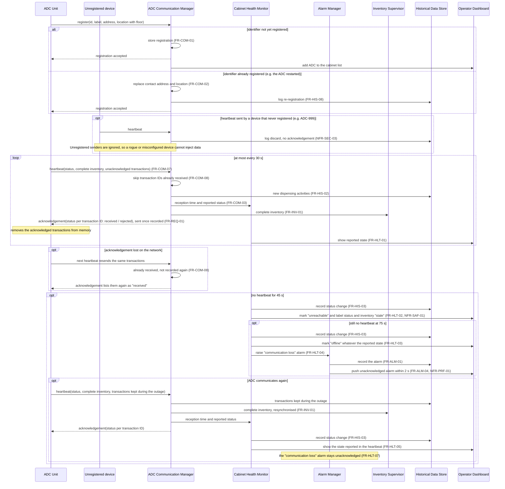
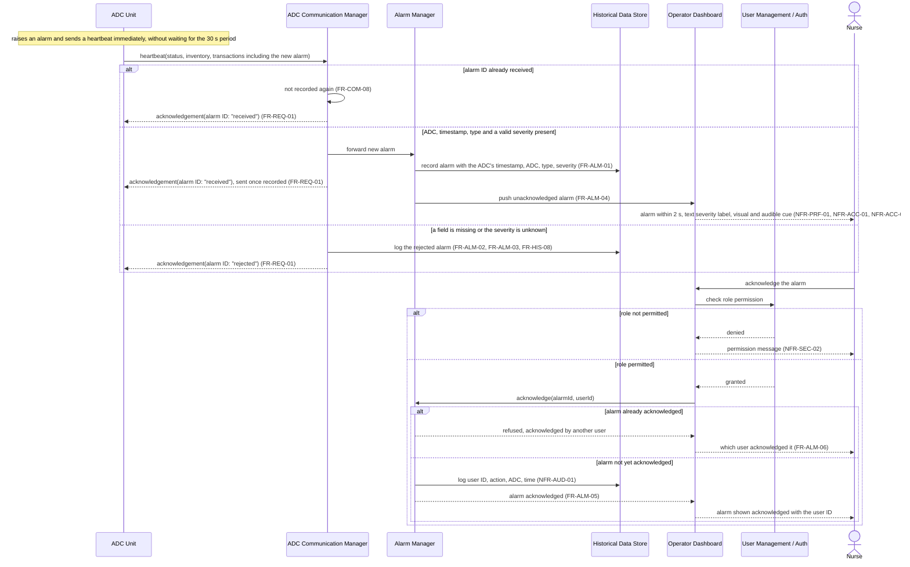
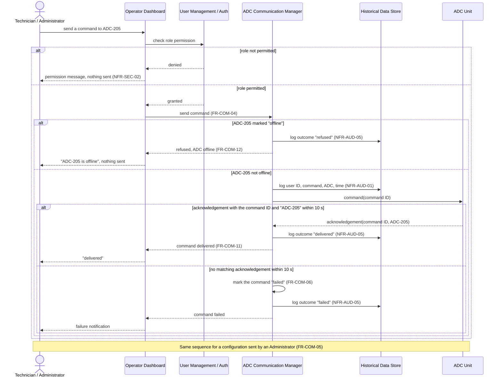

# Sequence Diagrams - Part B (Hospital Monitoring System)

ADCs are designated by their label (e.g. "ADC-205"); the messages carry their identifier, a UUID v4 (A-21).

## 1. ADC Registration and Heartbeat (Scenario 3)

## 2. Alarm Reception and Acknowledgement (Scenario 2)

## 3. Command or Configuration to an ADC

