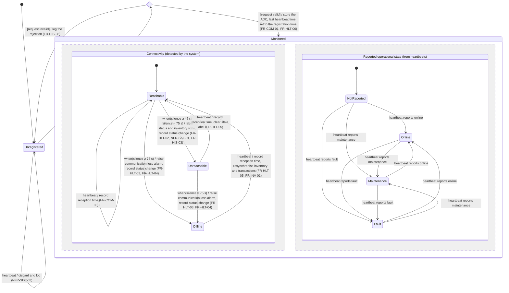
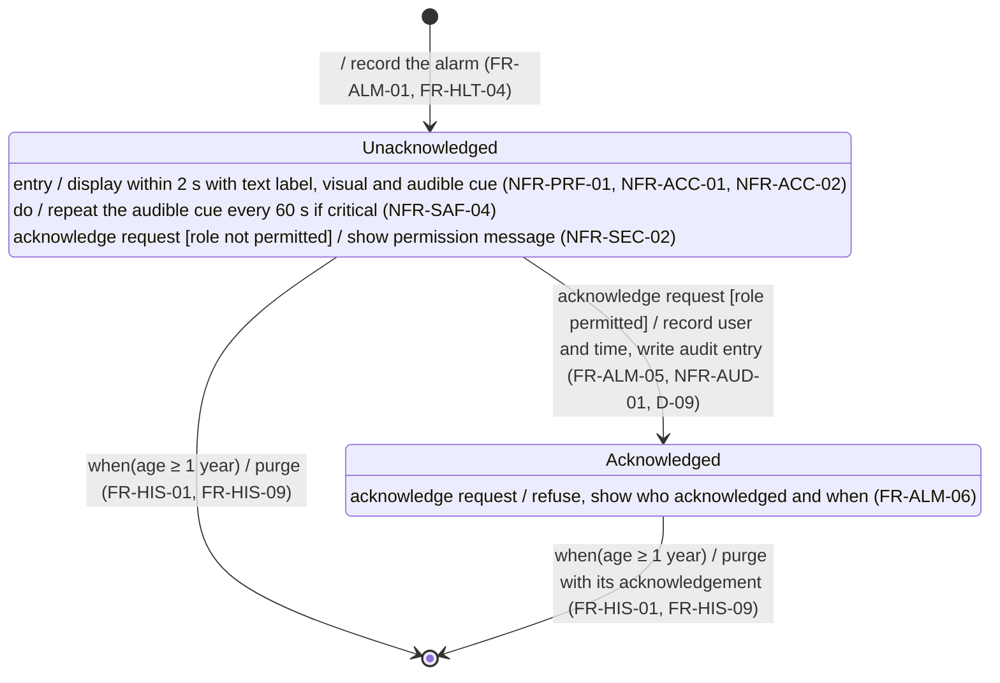

# State Machine Diagrams - Part B (Hospital Monitoring System)

Notation: `event [guard] / action`. Square brackets only hold guards; the requirements a transition realises are given in parentheses. `when(condition)` is a change event: the transition is taken as soon as the condition becomes true.

## 1. Cabinet Health & Connectivity State Machine

One instance per ADC identifier. `silence` is the time elapsed since the ADC's last valid heartbeat, or since its registration until its first heartbeat (FR-HLT-06).

The two regions of *Monitored* run in parallel for each registered ADC.

- **Timed transitions**: both thresholds are measured from the last heartbeat, not from the entry into the current state: an ADC silent since its last heartbeat becomes *Unreachable* at 45 s and *Offline* at 75 s. *Reachable* → *Offline* is taken only if the silence goes past 75 s before the 45 s transition was taken (for example, while the system restarts).
- **Displayed status** (D-02, NFR-SAF-03): UNREACHABLE or OFFLINE whenever the connectivity region is not in *Reachable*; otherwise the state of the reported operational region.
- **Commands**: a "maintenance mode" command changes nothing in this machine until a heartbeat reports "maintenance"; its outcome is tracked by the command itself (FR-COM-06, FR-COM-11).
- **Invalid events**:
  - a heartbeat from an unregistered ADC is discarded and logged, and the ADC stays *Unregistered* (NFR-SEC-03);
  - an invalid registration request leaves the ADC *Unregistered* (FR-HIS-08);
  - a registration of an already registered ADC (re-registration, e.g. after a restart) is an internal event of *Monitored*: it only replaces the ADC's label, contact address and location, and leaves both regions and the last heartbeat time unchanged (FR-COM-02).

## 2. Alarm Lifecycle State Machine

One instance per recorded alarm. An alarm is created in two ways: from a valid alarm transaction received in a heartbeat (FR-ALM-01), or by the system when an ADC is marked offline (communication loss alarm, severity "error", FR-HLT-04). A transaction that is incomplete, has an unknown severity or was already received never creates an alarm: it is rejected or acknowledged as a duplicate before (activity diagram 2, FR-ALM-02, FR-ALM-03, FR-COM-08). `age` is the time elapsed since the alarm was raised.

- **Internal transitions**: the refused acknowledgements are written inside the states (`event [guard] / action`). They do not leave the state, so the entry action (display and cue) is not executed again.
- **ADC communicating again**: no event of the ADC changes an alarm. A communication loss alarm stays *Unacknowledged* when its ADC comes back, until a user acknowledges it (FR-HLT-07, D-18).
- **Permitted roles**: nurse, pharmacist and technician (D-09).
