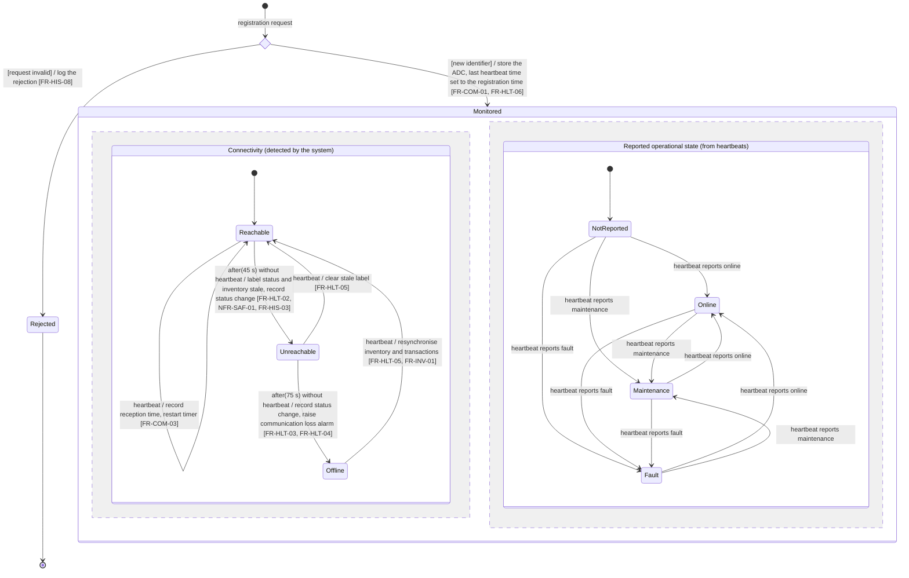
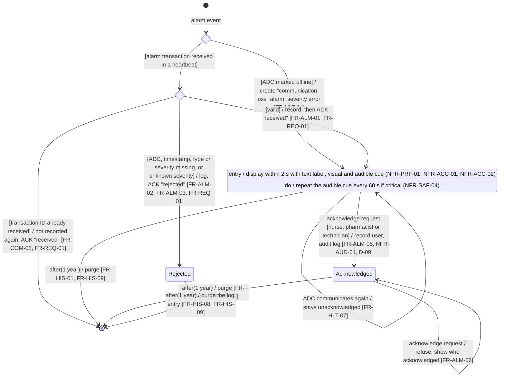

# State Machine Diagrams - Part B (Hospital Monitoring System)

## 1. Cabinet Health & Connectivity State Machine

The two regions run in parallel for each registered ADC.

- **Displayed status** (D-02, NFR-SAF-03): UNREACHABLE or OFFLINE whenever the connectivity region is not in *Reachable*; otherwise the state of the reported operational region.
- **Commands**: a "maintenance mode" command changes nothing in this machine until a heartbeat reports "maintenance"; its outcome is tracked by the command itself (FR-COM-06, FR-COM-11).
- **Invalid events**: a heartbeat from an unregistered ADC is discarded and logged, and causes no transition (NFR-SEC-03); a registration of an already registered ADC (re-registration, e.g. after a restart) only replaces its contact address and location and causes no transition: the connectivity and reported states, and the last heartbeat time, are kept (FR-COM-02).

## 2. Alarm Lifecycle State Machine

