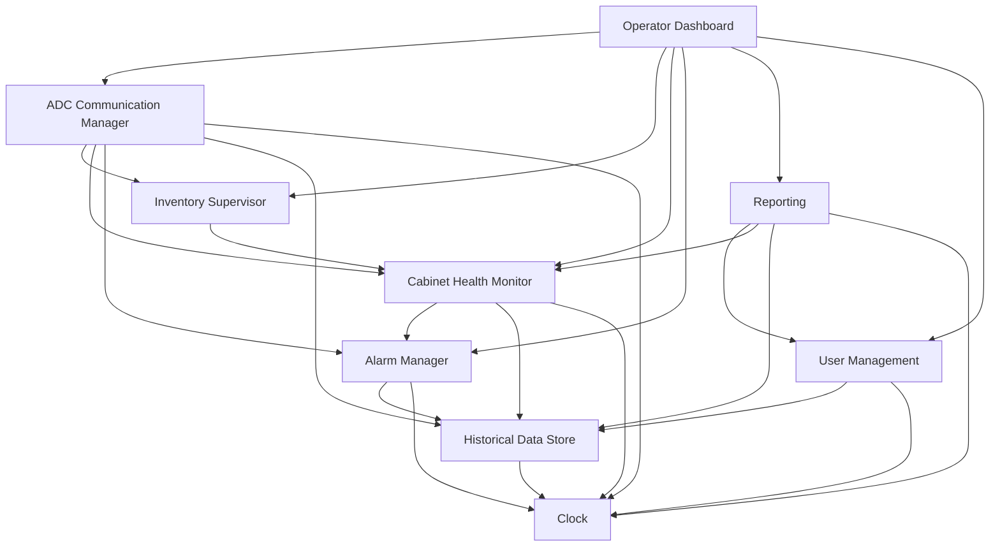

# Modular Decomposition - Part B (Hospital Monitoring System)

This document is the module guide of the Monitoring System. It follows Parnas's information hiding method: list the changes we anticipate, give each one to a single module as its secret, classify the modules, and check that the USES relation is a hierarchy. The interface of each module, and the folder that implements it, are in [modular-design-and-interfaces.md](modular-design-and-interfaces.md).

## 1. Anticipated changes

Each anticipated change is the secret of exactly one leaf module (section 2).

| ID | Anticipated change | Hidden by |
| --- | --- | --- |
| AC-01 | The source of time: the system clock in production, a clock moved by hand in tests, or in a demonstration that must jump forward (D-29) | Clock |
| AC-02 | The ADC ↔ Monitoring protocol: message encoding (JSON today), transport (HTTP today, a message broker tomorrow), endpoint paths, the contact address of each ADC (D-32) | ADC Communication Manager |
| AC-03 | How information reaches the operator: page layout, wording and language, delivery technology to the browser (Server-Sent Events today, WebSockets or a native client tomorrow, D-27), how the sound is played | Operator Dashboard |
| AC-04 | The connectivity rules: the 45 s and 75 s thresholds (D-01), the connectivity states and their transitions (SPEC-HLT-02) | Cabinet Health Monitor |
| AC-05 | The alarm lifecycle and presentation rules: which alarms repeat their audible cue and how often (60 s for critical ones today, SPEC-ALM-02), an escalation added later | Alarm Manager |
| AC-06 | The low-stock rules: the 10-box threshold (A-10), the rule to find another source (same floor today, D-05; nearest cabinet or whole building tomorrow) | Inventory Supervisor |
| AC-07 | The role → permission matrix (D-14), how accounts and passwords are stored | User Management |
| AC-08 | The report layouts, the export file format, the rule that hides patient identifiers from some roles (PHIPA, D-33) | Reporting |
| AC-09 | The storage technology (SQLite today, PostgreSQL tomorrow), the table layout, how the retention periods are enforced (FR-HIS-09) | Historical Data Store |

### Unlikely changes

These are fixed by the D1 requirements or by the contract with Part A. The design relies on them, so several modules may know them.

| ID | Unlikely change | Why it is taken as fixed |
| --- | --- | --- |
| UC-01 | The alarm severities (`info`, `warning`, `error`, `critical`) | Fixed by the interface contract with Part A and by FR-ALM-03 |
| UC-02 | ADCs, alarms, transactions and commands are identified by UUID v4 strings | Fixed by the interface contract with Part A |
| UC-03 | ADCs open the conversation for heartbeats; the Monitoring System opens it only for commands and configuration | Fixed by the interface contract with Part A |
| UC-04 | The roles of the users (nurse, pharmacist, technician, administrator, risk management) | Stakeholders of D1; what each role may do is AC-07, but the list of roles is not |
| UC-05 | One Monitoring System for the whole hospital | Scope of the project (D1 introduction) |

## 2. Module hierarchy

Modules 1.x are conceptual: they group leaf modules by the kind of secret they hide. Leaf modules (1.x.y) are the ones found in the code, one folder each under `monitoring/app/modules/`.

- **Hardware hiding** modules hide the devices at the boundary of the system: in the 4-variable model, they turn the inputs (I) into values the rest of the software uses, and the results back into outputs (O). Each one has a real and a simulated implementation behind the same interface, which is how the demonstration runs without real devices.
- **Behaviour hiding** modules hide the required behaviour that the specification lets change: thresholds, rules, presentation. Their secrets come from the D1 requirements and decisions.
- **Software decision hiding** modules hide choices made by the designers that the requirements do not impose.

| ID | Module | Responsibility | Secret |
| --- | --- | --- | --- |
| 1 | Monitoring System | Supervise the ADCs of the hospital | All the secrets below |
| 1.1 | Hardware hiding | Talk to the devices at the boundary: the time source, the ADCs, the operator workstations | How each device is reached and what its messages look like |
| 1.1.1 | Clock | Give the current time | AC-01. Real implementation: `ClockService`; simulated: `ManualClock` (tests) |
| 1.1.2 | ADC Communication Manager | Speak the ADC ↔ Monitoring protocol in both directions | AC-02. Real ADCs of Part A, or the ADC simulator (`monitoring/simulator/`) |
| 1.1.3 | Operator Dashboard | Show everything to the users and receive their requests | AC-03. The workstation's screen, keyboard and speaker are reached through the browser only |
| 1.2 | Behaviour hiding | Apply the rules of the specification | The rules that the hospital may change |
| 1.2.1 | Cabinet Health Monitor | Keep the registry of ADCs, their reported state and their connectivity | AC-04 |
| 1.2.2 | Alarm Manager | Record alarms, keep their acknowledgement state, announce them | AC-05 |
| 1.2.3 | Inventory Supervisor | Keep the latest inventory of each ADC, flag low stock, find sources | AC-06 |
| 1.2.4 | User Management | Manage accounts and roles, decide permissions | AC-07 |
| 1.2.5 | Reporting | Build, save and export reports; give users the event history and the audit log | AC-08 |
| 1.3 | Software decision hiding | Keep what the system must remember | Design choices not imposed by the requirements |
| 1.3.1 | Historical Data Store | Keep every record the system must retain, append-only, and answer queries over them | AC-09 |

Why the Historical Data Store is a software decision hiding module, although the database is an output device in the 4-variable model (`o_record`, [precise specification](precise-specification.md), section 2.5): a hardware hiding module hides a device imposed from outside, whose characteristics the team cannot choose (the ADCs of Part A, the operator's browser and speaker). The storage engine, its table layout and the way records are purged are chosen by the team; the requirements only ask that records be durable (NFR-REL-01) and kept for their retention period (SPEC-HIS-01). What the module hides is that choice (D-39).

Why the Operator Dashboard is a hardware hiding module: it is the only module that knows the operator's devices exist. The other modules produce values such as "this alarm is raised, repeat its cue every 60 s" (`AlarmEvent`); only the Dashboard turns them into pixels and sounds (the `o_` variables of the [precise specification](precise-specification.md), section 2.5), exactly as the ADC Communication Manager is the only module that turns HTTP messages into heartbeats and transactions.

## 3. USES hierarchy

Module A uses module B when A can only work correctly if B does. The relation below comes from the "Uses" line of each module in [modular-design-and-interfaces.md](modular-design-and-interfaces.md), section 3. An arrow A → B means "A uses B".

The relation has no cycle, so the modules can be built and tested bottom-up, level by level:

| Level | Modules | Uses only modules of level |
| --- | --- | --- |
| 0 | Clock | - |
| 1 | Historical Data Store | 0 |
| 2 | Alarm Manager, User Management | 0, 1 |
| 3 | Cabinet Health Monitor | 0 to 2 |
| 4 | Inventory Supervisor, Reporting | 0 to 3 |
| 5 | ADC Communication Manager | 0 to 4 |
| 6 | Operator Dashboard | 2 to 5 |

**Announcements are not uses.** The Alarm Manager and the Cabinet Health Monitor call the listeners that the Dashboard gave to `subscribe` (D-27), but they do not need the Dashboard to work correctly: a listener that fails is logged and the alarm stays recorded (D-36). This is why calling a listener does not create a cycle Alarm Manager → Dashboard.

The unit tests follow this order: a module is tested with the real modules below it, or with a simulated one when the real one is not written yet (`tests/helpers/fake_modules.ts`).

## 4. Design review test

For each anticipated change, the code that changes stays inside one module.

| Change | What changes | Modules touched |
| --- | --- | --- |
| AC-01: the demonstration needs time to jump by 75 s | `ManualClock` is swapped for `ClockService` (`app.container.swap`) | Clock only |
| AC-02: heartbeats move from HTTP to a message broker | Routes and `protocol.ts` | ADC Communication Manager only |
| AC-03: Server-Sent Events replaced by WebSockets | `live_channel.ts` and the pages' script | Operator Dashboard only |
| AC-04: the offline threshold becomes 60 s | One constant | Cabinet Health Monitor only |
| AC-05: warnings also repeat their cue, every 5 minutes | The computation of `audibleRepeatSeconds` | Alarm Manager only (the Dashboard plays whatever period it receives) |
| AC-06: sources searched in the whole building | The search in `findSources` | Inventory Supervisor only (the Cabinet Health Monitor already gives the reachable ADCs) |
| AC-07: administrators may now acknowledge alarms | The permission matrix | User Management only (D-31: no other module checks roles) |
| AC-08: alarm reports exported as PDF | `exportReport` | Reporting only |
| AC-09: SQLite replaced by PostgreSQL | Database configuration and Lucid models | Historical Data Store only (no Lucid model crosses an interface) |

A leak found by this test and fixed: the description of the communication loss alarm used to say "silent >= 75 seconds". The 75 s threshold is the secret of the Cabinet Health Monitor (AC-04); written in the Alarm Manager, a change of threshold would have touched two modules. The description now says only that communication is lost.
