# Precise Specification - Part B (Hospital Monitoring System)

## 1. Purpose and conventions

This section refines the Deliverable 1 requirements into a precise, unambiguous specification of the required behaviour. It uses the **4-variable model** (Parnas and Madey) to fix the system boundary: what the system watches in its environment (monitored variables), what it must control there (controlled variables), what the software actually receives and emits (input and output variables), and the relations between them (NAT, REQ, IN, OUT).

- **Deliverable 1 identifiers are kept.** No FR, NFR, US, A or D identifier is renumbered. Each specification item below names the D1 requirements it refines.
- **Specification items** are numbered `SPEC-<theme>-<nn>`, with the same themes as the D1 requirements (COM, HLT, INV, ALM, USR, HIS). The prefix `REQ-` is not used, to avoid any confusion with the D1 theme "Request Handling" (`FR-REQ-01`). The traceability table (section 5) extends each D1 requirement forward to these items.
- **Function tables** are read row by row: when the condition of a row holds, the variables of that row take the given values. In every table, the conditions are **disjoint** (no two rows hold at once) and **complete** (one row always holds); this was checked for every table.
- **Safety-critical functions.** The four-variable model (section 2) frames the whole system once. Section 3 gives a function table for every requirement that needed one; five functions, whose failure could hurt a patient, are specified further with pre-conditions, post-conditions and state invariants in [safety-critical-specifications.md](safety-critical-specifications.md): offline detection, alarm reception, alarm acknowledgement, command sending, and status and stock display. Their items are SPEC-HLT-01, SPEC-HLT-02, SPEC-COM-03 to 05, SPEC-ALM-01, SPEC-ALM-02, SPEC-INV-01 and SPEC-INV-02.
- **Items written on inputs and outputs.** REQ is stated with monitored and controlled variables only, except for the ADC communication items SPEC-COM-01, 02, 03 and 05. The FR-COM requirements they refine are themselves about messages (accept a registration, acknowledge each transaction, mark a command delivered only if its acknowledgement carries the right identifiers), so these items state their conditions on the input variables of section 2.4 (`i_register`, `i_heartbeat`, `i_cmdResponse`) and give the outputs of section 2.5 in the terms of the interface contract (HTTP status, error code). They specify the interface with the ADCs, which is part of the requirements (FR-COM-01 to 12, interface contract), not a design choice of this team.
- **Naming**: `m_` monitored, `c_` controlled, `i_` input, `o_` output; enumerated values are written `e_value`. `t` is the current time (`m_time`), in seconds. `a`, `b` denote ADCs, `med` a medication, `u` a user, `x` an alarm, `k` a command or configuration.
- Every value shown to users uses the single label fixed by D-16 (NFR-USA-02).

## 2. The 4-variable model of the Monitoring System

### 2.1 System boundary

The Monitoring System does not touch any physical hardware (part-b.pdf §4). Its "sensors" and "actuators" are the other systems it is connected to: on one side the ADC units, through the hospital network and the interface contract ([interface-adc-monitoring.md](../interface-adc-monitoring.md)); on the other side the operator workstation (screen, speaker, keyboard, pointer) through a web browser. The environment it monitors and controls is therefore made of the ADCs and of the people in front of the dashboard.

```mermaid
flowchart LR
    M["<b>M</b> monitored variables<br/>ADC state, stock, alarms,<br/>dispensings, last contact,<br/>user actions, time"]
    I["<b>I</b> input variables<br/>registrations, heartbeats,<br/>command responses,<br/>HTTP requests, clock"]
    Mp["<b>M_p</b><br/>reported state, silence,<br/>latest inventory, valid<br/>transactions, user and role"]
    Cp["<b>C_p</b><br/>status to show, flags,<br/>alarm list, outcomes,<br/>acknowledgements"]
    O["<b>O</b> output variables<br/>pages, live events, sound,<br/>ADC responses, commands,<br/>configurations, records"]
    C["<b>C</b> controlled variables<br/>what users see and hear,<br/>ADC mode and settings,<br/>transaction statuses, records"]

    M -- "IN: ADC software + HTTPS,<br/>keyboard, browser, clock" --> I
    I -- "SOF_in" --> Mp
    Mp -- "SOF_req" --> Cp
    Cp -- "SOF_out" --> O
    O -- "OUT: browser, screen, speaker,<br/>HTTPS + ADC software, storage" --> C
    M == "REQ (section 3), under NAT (section 2.6)" ==> C

    classDef env fill:#e8eef7,stroke:#334,stroke-width:1.5px,color:#111;
    classDef sw fill:#e6f4ea,stroke:#2e7d32,stroke-width:1.5px,color:#111;
    class M,C env;
    class I,Mp,Cp,O sw;
```

The required behaviour (REQ, section 3) is stated with monitored and controlled variables only. The software design works on input and output variables; it is split, following the modified 4-variable model, into `SOF_in` (turns raw inputs into software-usable versions of the monitored variables, `M_p`), `SOF_req` (computes the software-usable controlled values, `C_p`) and `SOF_out` (turns them into outputs). In the D1 architecture, `SOF_in` is the input side of the ADC Communication Manager and the request handling of the Operator Dashboard; `SOF_req` is the Cabinet Health Monitor, Alarm Manager, Inventory Supervisor, User Management and Reporting; `SOF_out` is the rendering side of the Operator Dashboard, the output side of the ADC Communication Manager and the Historical Data Store. Section 3 of the design document refines these components into modules.

### 2.2 Monitored variables (M)

| Variable | Meaning | Type / range |
| --- | --- | --- |
| `m_time` | Current hospital time | Timestamp (UTC, ms) |
| `m_adcIdentity(a)` | What ADC `a` declares about itself: label, contact address, location (floor, description) | Label ≤ 128 chars; `https://` URL; floor: integer; description: text |
| `m_adcState(a)` | Operational state of ADC `a` | {`e_online`, `e_maintenance`, `e_fault`} |
| `m_adcStock(a, med)` | Number of boxes of medication `med` held by ADC `a` | Integer ≥ 0 |
| `m_alarm(a)` | Alarm events raised by ADC `a`, each with its identifier, time, type, severity and description | Set of events |
| `m_dispensing(a)` | Dispensing events of ADC `a`, each with its identifier, time, medication, quantity, patient and staff member | Set of events |
| `m_lastContact(a)` | Time at which ADC `a` last delivered a valid heartbeat; registration time until its first one (FR-HLT-06) | Timestamp |
| `m_cmdReaction(k)` | What the target ADC did with command or configuration `k` | {`e_applied`, `e_refused(code)`, `e_noReaction`} |
| `m_userAction(u)` | Action requested by the person at the workstation: log in, acknowledge an alarm, send a command or configuration, view a page, generate a report, manage an account | Event, with its parameters |
| `m_userIdentity(u)` | Who is actually at the workstation, as proven by credentials | User account or none |

`m_lastContact(a)` is an intermediate quantity (W5, "System Requirements: Review"): the Monitoring System cannot observe `m_adcState(a)` directly, only what an ADC delivers. The silence of an ADC is defined from it:

> `silence(a) = m_time − m_lastContact(a)`

### 2.3 Controlled variables (C)

| Variable | Meaning | Type / range |
| --- | --- | --- |
| `c_displayedStatus(a)` | Status of ADC `a` as read by users on the dashboard | {`ONLINE`, `MAINTENANCE`, `FAULT`, `UNREACHABLE`, `OFFLINE`, `PENDING`} (`PENDING`: D-21) |
| `c_stale(a)` | "stale" label, with the last-update time, shown next to the status and inventory of `a` | Boolean + timestamp |
| `c_displayedStock(a, med)` | Quantity of `med` shown for ADC `a`, with the time of the heartbeat it comes from | Integer ≥ 0 + timestamp |
| `c_lowStock(a, med)` | "Low Stock" flag shown for `med` in ADC `a` | Boolean |
| `c_stockSources(a, med)` | Same-floor ADCs proposed as sources of `med`, or the message "no stock available" | Set of ADC labels, or message |
| `c_alarmList` | Unacknowledged alarms shown to dashboard users, each with text labels for its ADC, type and severity, and a visual cue | List |
| `c_audibleCue` | Sound played on the workstation for an alarm | Event |
| `c_alarmAck(x)` | Acknowledgement state of alarm `x`, as shown to users | `e_unacknowledged`, or `e_acknowledged(u, t)` |
| `c_adcMode(a)` | Maintenance mode requested from ADC `a` | {`e_maintenanceOn`, `e_maintenanceOff`} |
| `c_adcSettings(a)` | Configuration settings requested from ADC `a` | `timeServer`, `screenLockTimeoutSeconds` |
| `c_cmdOutcome(k)` | Outcome of command or configuration `k`, as shown to its sender | {`e_pending`, `e_delivered`, `e_failed(code)`, `e_refused`} |
| `c_txnStatus(id)` | Status of transaction `id` as known by the ADC that sent it (the ADC frees its memory on it) | {`e_received`, `e_rejected(reason)`} |
| `c_registration(a)` | Registration answer known by ADC `a` | {`e_registered(first)`, `e_rejected`} |
| `c_access(u, f)` | Whether user `u` is given dashboard function `f` | Boolean |
| `c_patientIdShown(u)` | Whether patient identifiers appear in what `u` reads | Boolean |
| `c_records` | Historical data, audit log and system log available for review | Set of entries, each with its timestamp |

### 2.4 Input variables (I) and the IN relation

| Monitored | Input device | Software sees | IN: accuracy, delay, failure modes |
| --- | --- | --- | --- |
| `m_time` | Server clock, synchronized with the hospital time server | `i_now` | `i_now ≈ m_time` within the synchronization error |
| `m_adcIdentity(a)` | ADC software, HTTPS | `i_register` (`POST /api/v1/adcs/register`) | Sent at every ADC start-up and after a `404 ADC_NOT_REGISTERED` (A-22) |
| `m_adcState(a)` | ADC software, HTTPS | `i_heartbeat.state` | Known at the time of the heartbeat: at most 30 s old (A-05), sent at once when the state changes (A-08); lost while the network or the ADC is down |
| `m_adcStock(a, ·)` | ADC software, HTTPS | `i_heartbeat.inventory[]` | Complete inventory, same delay as the state (FR-COM-07) |
| `m_alarm(a)` | ADC software, HTTPS | `i_heartbeat.transactions[]` with `type = alarm` | Sent at once when raised (A-08); timestamp set by the ADC (A-14); repeated until acknowledged (A-06), hence possibly received twice (D-07); possibly malformed (D-08) |
| `m_dispensing(a)` | ADC software, HTTPS | `i_heartbeat.transactions[]` with `type = dispensing` | Sent with the next heartbeat (≤ 30 s); same repetition and malformation cases |
| `m_lastContact(a)` | ADC software, HTTPS, server clock | `i_hbReceivedAt(a)`: `i_now` when a heartbeat of `a` is answered `200` | Later than the sending by the network transit time; a heartbeat answered with an error is not counted (interface §3.2) |
| `m_cmdReaction(k)` | ADC software, HTTPS | `i_cmdResponse(k)`: `200` body (`commandId` or `configurationId`, `adcId`, `status`), error code, timeout (10 s) or connection error | `e_applied` is seen only if the answer arrives within 10 s; a lost answer looks like `e_noReaction` (interface §7) |
| `m_userAction(u)` | Keyboard, pointer, browser | `i_request`: HTTP request with session cookie, route and parameters | Keyboard-only use is possible (NFR-ACC-03) |
| `m_userIdentity(u)` | Login form | `i_credentials` (username, password), then the session | Holds as long as credentials are not shared (A-04) |

A heartbeat from a device that is not registered is an input with no monitored counterpart: it is discarded (SPEC-COM-02).

### 2.5 Output variables (O) and the OUT relation

| Software writes | Output device | Controlled | OUT: effect and assumptions |
| --- | --- | --- | --- |
| `o_page`: server-rendered HTML page | Browser, workstation screen | `c_displayedStatus`, `c_stale`, `c_displayedStock`, `c_lowStock`, `c_stockSources`, `c_alarmList`, `c_alarmAck`, `c_cmdOutcome`, `c_patientIdShown` | Shown when a user opens or reloads a page |
| `o_liveEvent`: Server-Sent Event pushed to the open dashboards | Browser, workstation screen | Same as `o_page`, without reload | Shown while a dashboard is open and its browser connected |
| `o_sound`: order to play the alarm sound | Browser, workstation speaker | `c_audibleCue` | Heard if the speaker is on and audible (A-25) |
| `o_registerResponse` | HTTPS, ADC software | `c_registration(a)` | The ADC sends its first heartbeat after a `200` |
| `o_hbResponse`: one acknowledgement per transaction | HTTPS, ADC software | `c_txnStatus(id)` | The ADC removes each acknowledged transaction from its memory; a lost response makes it resend them (D-07) |
| `o_command`: `POST {contactAddress}/api/v1/commands` | HTTPS, ADC software | `c_adcMode(a)` | Applied by the ADC unless it answers an error (interface §4.1) |
| `o_configuration`: `POST {contactAddress}/api/v1/configuration` | HTTPS, ADC software | `c_adcSettings(a)` | All the settings or none (interface §4.2) |
| `o_record`: database write | Server storage | `c_records` | Durable once written (NFR-REL-01) |

### 2.6 NAT: constraints of the environment

These hold whatever the software does; the specification relies on them.

| ID | Constraint | Source |
| --- | --- | --- |
| NAT-01 | An ADC is in exactly one operational state at a time. | A-11 |
| NAT-02 | Stock quantities are integers ≥ 0, and an ADC holds at most one stock entry per medication. | Interface §3.2 |
| NAT-03 | An ADC that runs and can reach the Monitoring System delivers a heartbeat at least every 30 s, and at once when it raises an alarm or changes its state. | A-05, A-08 |
| NAT-04 | An ADC keeps every transaction until it is acknowledged, and sends at most one heartbeat at a time. | A-06, A-23, A-24 |
| NAT-05 | Identifiers are UUID v4: transaction identifiers are unique across all ADCs, and an ADC keeps its identifier across restarts. | A-07, A-21 |
| NAT-06 | The clocks of the ADCs and of the Monitoring System are synchronized with the hospital time server. | Interface §2 |
| NAT-07 | Time only moves forward, so `silence(a)` grows between two heartbeats of `a` and goes through 45 s before 75 s. | - |

## 3. Required behaviour (REQ)

### 3.1 Cabinet health and status display (HLT)

Notation: `reported(a)` is the state carried by the latest valid heartbeat of `a`, or `⊥` if none has been received since its first registration; `label(e_online) = ONLINE`, `label(e_maintenance) = MAINTENANCE`, `label(e_fault) = FAULT` (D-16).

**SPEC-HLT-01 - Displayed status of ADC `a`**
Refines FR-HLT-01, FR-HLT-02, FR-HLT-03, FR-HLT-05, FR-HLT-06, FR-DSH-01, NFR-SAF-01, NFR-SAF-03 (D-01, D-02, D-03, D-21, D-22).

| Condition | `c_displayedStatus(a)` | `c_stale(a)` |
| --- | --- | --- |
| `silence(a) < 45` ∧ `reported(a) = ⊥` | `PENDING` (D-21) | false |
| `silence(a) < 45` ∧ `reported(a) ≠ ⊥` | `label(reported(a))` | false |
| `45 ≤ silence(a) < 75` | `UNREACHABLE` | true, with `m_lastContact(a)` |
| `silence(a) ≥ 75` | `OFFLINE` | true, with `m_lastContact(a)` |

- Timing: the displayed status follows a change of row within 2 s (D-22).
- `ONLINE` is shown only in the second row, so never while `silence(a) ≥ 45` (NFR-SAF-03).
- The same stale label applies to the inventory of `a` (`c_displayedStock`, NFR-SAF-01).

**SPEC-HLT-02 - Connectivity of ADC `a`: states × events**
Refines FR-HLT-02, FR-HLT-03, FR-HLT-04, FR-HLT-07, FR-HIS-03, FR-COM-02, NFR-SEC-03 (D-15, D-18, D-20). Realizes the "Connectivity" region of the D1 state machine. Connectivity is `Reachable` while `silence(a) < 45`, `Unreachable` while `45 ≤ silence(a) < 75`, `Offline` while `silence(a) ≥ 75`.

| State \ Event | Valid heartbeat of `a` | `silence(a)` reaches 45 s | `silence(a)` reaches 75 s | Re-registration of `a` | Heartbeat refused (invalid or unregistered) |
| --- | --- | --- | --- | --- | --- |
| `Reachable` | stays `Reachable`; `silence(a)` back to 0 | → `Unreachable`; status change recorded | impossible (NAT-07) | no change (D-20) | no change |
| `Unreachable` | → `Reachable`; status change recorded | impossible | → `Offline`; status change recorded; communication loss alarm raised (type `communication_loss`, severity error) | no change | no change |
| `Offline` | → `Reachable`; status change recorded; the communication loss alarm keeps its acknowledgement state (FR-HLT-07) | impossible | impossible | no change | no change |

A valid heartbeat whose `state` differs from `reported(a)` also records a status change (FR-HIS-03), whatever the connectivity.

### 3.2 ADC communication (COM)

**SPEC-COM-01 - Registration request `r` received**
Refines FR-COM-01, FR-COM-02, FR-HLT-06, FR-HIS-08 (D-20, A-22).

| Condition | Effect | `c_registration` |
| --- | --- | --- |
| `r` invalid: a field of interface §3.1 is missing or breaks its rule | Nothing registered; rejection written to the system log | `e_rejected` (`400 INVALID_MESSAGE`) |
| `r` valid ∧ `r.adcId` not registered | `a` registered with its label, contact address and location; its registration time counts as its last contact (FR-HLT-06); `reported(a) := ⊥` | `e_registered(first = true)` |
| `r` valid ∧ `r.adcId` registered | Label, contact address and location replaced; re-registration written to the system log; last contact, `reported(a)`, connectivity and alarms unchanged | `e_registered(first = false)` |

**SPEC-COM-02 - Heartbeat `h` received**
Refines FR-COM-03, FR-COM-07, FR-INV-01, FR-REQ-01, NFR-SEC-03, NFR-REL-03, FR-HIS-08.

| Condition | Effect | Response |
| --- | --- | --- |
| Envelope of `h` invalid (interface §3.2), or a transaction without a usable `transactionId` | Nothing recorded; not counted as a heartbeat | `400 INVALID_MESSAGE` |
| Envelope valid ∧ `h.adcId` not registered | Discarded; discard written to the system log | `404 ADC_NOT_REGISTERED` |
| Envelope valid ∧ `h.adcId` registered | Counts as a contact of `a` (`silence(a)` back to 0); `reported(a) := h.state`; stored inventory of `a` := `h.inventory` (complete replacement); each transaction handled by SPEC-COM-03 | `200`, sent only after every transaction has been handled; one acknowledgement per transaction, in the order of `h` |

**SPEC-COM-03 - Transaction `x` of a valid heartbeat from ADC `a`**
Refines FR-COM-08, FR-COM-09, FR-COM-10, FR-ALM-01, FR-ALM-02, FR-ALM-03, FR-HIS-08 (D-07, D-08, A-14, A-20). The originating ADC of `x` is `a`, the sender of the heartbeat (A-20). "Recorded" means already stored by an earlier heartbeat.

| Condition | Effect | `c_txnStatus(x.id)` |
| --- | --- | --- |
| `x.id` recorded | Not recorded again | `e_received` |
| `x.id` not recorded ∧ `x.type ∉ {alarm, dispensing}` | Rejection logged | `e_rejected(UNKNOWN_TYPE)` |
| `x.id` not recorded ∧ `x.type = alarm` ∧ a required field missing (`timestamp`, `alarmType`, `severity`) | Rejection logged | `e_rejected(MISSING_FIELD)` |
| `x.id` not recorded ∧ `x.type = alarm` ∧ fields present ∧ `x.severity ∉ {info, warning, error, critical}` | Rejection logged | `e_rejected(INVALID_SEVERITY)` |
| `x.id` not recorded ∧ `x.type = alarm` ∧ fields present ∧ severity valid ∧ (a value has a wrong format ∨ `x.alarmType = communication_loss`) | Rejection logged | `e_rejected(INVALID_VALUE)` |
| `x.id` not recorded ∧ `x.type = alarm` ∧ fields present ∧ severity valid ∧ values well formed ∧ `x.alarmType ≠ communication_loss` | Alarm recorded, unacknowledged, with the ADC timestamp, `a`, its type (unknown types kept as received) and its severity | `e_received` |
| `x.id` not recorded ∧ `x.type = dispensing` ∧ a required field of FR-COM-09 missing | Rejection logged | `e_rejected(MISSING_FIELD)` |
| `x.id` not recorded ∧ `x.type = dispensing` ∧ fields present ∧ a value has a wrong format (UUID, timestamp, `quantityInBoxes < 1`) | Rejection logged | `e_rejected(INVALID_VALUE)` |
| `x.id` not recorded ∧ `x.type = dispensing` ∧ fields present ∧ values well formed | Dispensing activity recorded | `e_received` |

A rejected transaction is never recorded, so if an ADC sends it again it is rejected again with the same reason.

**SPEC-COM-04 - User `u` asks to send command or configuration `k` to ADC `a`**
Refines FR-COM-04, FR-COM-05, FR-COM-12, NFR-SEC-02, NFR-AUD-01, NFR-AUD-05 (D-04, D-10, D-26). `permitted(u, k)`: `k` is a command and `u` is a technician or an administrator, or `k` is a configuration and `u` is an administrator.

| Condition | Effect | `c_cmdOutcome(k)` |
| --- | --- | --- |
| `¬permitted(u, k)` | Nothing sent; permission message shown; not audited (D-26) | - (no `k` created) |
| `permitted(u, k)` ∧ `silence(a) ≥ 75` (`a` offline) | Nothing sent; user told the request is refused; outcome logged | `e_refused` |
| `permitted(u, k)` ∧ `silence(a) < 75` | `k` sent to `a` with a new identifier; sending logged (user, action, `a`, `t`) | `e_pending`, then SPEC-COM-05 |

An unreachable ADC (`45 ≤ silence(a) < 75`) still receives the command (interface §7).

**SPEC-COM-05 - Outcome of command or configuration `k` sent to ADC `a`**
Refines FR-COM-06, FR-COM-11, NFR-AUD-05 (D-04).

| Condition (within 10 s of the sending) | `c_cmdOutcome(k)` |
| --- | --- |
| Response `200` ∧ response identifier = `k.id` ∧ response `adcId` = `a` | `e_delivered` |
| Response `200` ∧ (response identifier ≠ `k.id` ∨ response `adcId` ≠ `a`) | `e_failed(ID_MISMATCH)` |
| Error response (4xx, 5xx) | `e_failed(code)`, with the code and message of the ADC |
| No response within 10 s, or connection error | `e_failed(TIMEOUT)` |

In every row the outcome is shown to the sender and logged with `k.id`, `a` and `t`. Nothing is resent automatically: the user decides whether to send again (D-04).

### 3.3 Inventory supervision (INV)

Notation: `q(b, med)` is the quantity of `med` in the latest stored inventory of ADC `b`; `S(a, med) = { b ≠ a | floor(b) = floor(a) ∧ q(b, med) > 10 ∧ silence(b) < 45 }` (the last condition is D-23).

**SPEC-INV-01 - Low stock flag and sources of `med` in ADC `a`**, for every `med` present in the latest inventory of `a`
Refines FR-INV-03, FR-INV-04, FR-INV-05, NFR-USA-01 (A-10, D-05, D-23, D-24).

| Condition | `c_lowStock(a, med)` | `c_stockSources(a, med)` |
| --- | --- | --- |
| `q(a, med) ≥ 10` | false | none shown |
| `q(a, med) < 10` ∧ `S(a, med) ≠ ∅` | true | labels of the ADCs of `S(a, med)` |
| `q(a, med) < 10` ∧ `S(a, med) = ∅` | true | "no stock available" |

The threshold is 10 boxes for flagging and more than 10 boxes for being a source: an ADC proposed as a source still holds at least 10 boxes after giving one box, so moving stock never creates a new low-stock flag. A medication absent from the inventory of `a` is not flagged (D-24).

**SPEC-INV-02 - Displayed stock**
Refines FR-INV-02, FR-INV-06, NFR-REL-03: `c_displayedStock(a, med) = q(a, med)`, with the time of the heartbeat it comes from; the aggregated quantity of `med` is `Σ_b q(b, med)` over all registered ADCs.

### 3.4 Alarm management (ALM)

**SPEC-ALM-01 - User `u` asks to acknowledge alarm `x`**
Refines FR-ALM-05, FR-ALM-06, NFR-SAF-02, NFR-SEC-02, NFR-AUD-01 (D-09, D-26).

| Condition | `c_alarmAck(x)` | Other effect |
| --- | --- | --- |
| `role(u) ∉ {nurse, pharmacist, technician}` | unchanged | Permission message shown; not audited (D-26) |
| `role(u) ∈ {nurse, pharmacist, technician}` ∧ `c_alarmAck(x) = e_acknowledged(v, t')` | unchanged | Refusal shown, naming `v` and `t'` |
| `role(u) ∈ {nurse, pharmacist, technician}` ∧ `c_alarmAck(x) = e_unacknowledged` | `e_acknowledged(u, t)` | Removed from `c_alarmList`; audit entry (`u`, acknowledgement, ADC of `x`, `t`); repetition of the audible cue stops |

No other event changes `c_alarmAck(x)` (NFR-SAF-02): in particular, an ADC that communicates again leaves its communication loss alarm unacknowledged (FR-HLT-07).

**SPEC-ALM-02 - Presentation of alarm `x` recorded or raised at time `t₀`**
Refines FR-ALM-04, NFR-PRF-01, NFR-PRF-02, NFR-SAF-04, NFR-ACC-01, NFR-ACC-02.

| Condition | In `c_alarmList` | `c_audibleCue` |
| --- | --- | --- |
| `c_alarmAck(x) = e_unacknowledged` ∧ `x.severity = critical` | yes, from `t₀ + 2 s` at the latest, with text labels and a visual cue | at first display, then every 60 s |
| `c_alarmAck(x) = e_unacknowledged` ∧ `x.severity ≠ critical` | yes, from `t₀ + 2 s` at the latest, with text labels and a visual cue | at first display only |
| `c_alarmAck(x) = e_acknowledged(·)` | no | none |

The 2-second bound holds with at least 50 ADCs connected (NFR-PRF-02). `t₀` is the reception time for an alarm from an ADC, and the generation time for a communication loss alarm.

### 3.5 Users and access (USR)

**SPEC-USR-01 - Request of a dashboard function `f` by the person at the workstation**
Refines FR-USR-01, FR-USR-02, FR-USR-05, NFR-SEC-01, NFR-SEC-02 (D-14, D-25). `allowed(f)` is the set of roles of the D-14 matrix for `f`.

| Condition | `c_access(u, f)` | Effect |
| --- | --- | --- |
| No authenticated session | false | Login page shown; no patient or medication data shown |
| Session of `u` ∧ account of `u` deactivated | false | Session closed; login page shown (D-25) |
| Session of `u` ∧ account active ∧ `role(u) ∉ allowed(f)` | false | Permission message shown |
| Session of `u` ∧ account active ∧ `role(u) ∈ allowed(f)` | true | `f` performed |

`role(u)` is the role read at the login of `u` (FR-USR-04).

**SPEC-USR-02 - Patient identifiers in a report or an event history read by `u`**
Refines NFR-SEC-04, NFR-AUD-06 (D-11).

| Condition | `c_patientIdShown(u)` | Effect |
| --- | --- | --- |
| `role(u) ∈ {pharmacist, administrator}` | true | Display logged (`u`, report or ADC history, `t`) |
| `role(u) ∉ {pharmacist, administrator}` | false | Identifiers left out |

### 3.6 Historical data (HIS)

**SPEC-HIS-01 - Retention of a stored item `e` with event date `d`**
Refines FR-HIS-01, FR-HIS-02, FR-HIS-03, FR-HIS-05, FR-HIS-06, FR-HIS-08, FR-HIS-09, NFR-AUD-02, NFR-AUD-03 (D-06).

| Kind of `e` | Retention `R` |
| --- | --- |
| Alarm (from an ADC or communication loss), audit log entry, generated report, system log entry | 1 year |
| Dispensing activity, status change | 6 months |
| Inventory | Until replaced by the next heartbeat of the same ADC |

For every kind: `e ∈ c_records` while `t < d + R`, and `e ∉ c_records` once `t ≥ d + R + 24 h`. No user role can modify or delete `e` before then.

## 4. Gaps found while refining the D1 requirements

Writing complete tables exposed cases that the D1 requirements left open. The team resolved each of them with a new decision or assumption, recorded in the assumptions and decisions section; the D1 requirements themselves are unchanged.

| Gap | Resolution | Recorded as | Used in |
| --- | --- | --- | --- |
| Between its first registration and its first heartbeat, an ADC has no reported state, and no D-16 label applies. | New label `PENDING`, shown until the first heartbeat (normally less than a second, interface §3.1). | D-21 (and D-16) | SPEC-HLT-01 |
| No requirement bounds the delay between a status change and its display (NFR-PRF-01 covers alarms only). | Same 2-second bound as alarms. | D-22 | SPEC-HLT-01 |
| FR-INV-04 would propose as a source an ADC that is unreachable or offline, whose stock is stale. | Only ADCs with `silence < 45` are proposed as sources. | D-23 | SPEC-INV-01 |
| A medication missing from the inventory of an ADC is neither "low" nor "not low". | Not flagged: the system cannot know that this ADC should hold it. | D-24 | SPEC-INV-01 |
| FR-USR-05 refuses a deactivated account at login, but says nothing about an open session. | The session is closed on the next request. | D-25 | SPEC-USR-01 |
| A request refused because of the role is not in the audit log (NFR-AUD-01 lists performed actions only). | Not logged; only the permission message is shown. | D-26 | SPEC-COM-04, SPEC-ALM-01 |
| FR-HIS-03 keeps every status change, but does not say whether the arrival of a new ADC is one. | Yes: the first registration records the first status (no reported state, reachable). | D-40 | SPEC-HIS-01 |
| The audible cue assumes a working speaker on the workstation. | Each operator workstation has a working, audible speaker. | A-25 | `o_sound` (section 2.5), SPEC-ALM-02 |

## 5. Traceability: D1 requirements → specification

This table gives the precise-specification column of the traceability table of this document, which lists every requirement with its specification, its module and its code; it is kept here to show which items refine which requirements.

Requirements not listed here are not refined by a function table: their D1 statement is already precise enough to be implemented and tested as it stands (FR-COM-09, FR-DSH-02, FR-DSH-03, FR-HIS-04, FR-HIS-07, FR-RPT-01 to 08, FR-USR-03, FR-USR-04, NFR-AUD-04), or they are quality targets verified by measurement and not by a relation between M and C (NFR-REL-02, NFR-AVL-01 to 05, NFR-USA-03, NFR-ACC-03, NFR-ACC-04, NFR-SEC-05).

| D1 requirement | Specification items |
| --- | --- |
| FR-COM-01, FR-COM-02 | SPEC-COM-01, SPEC-HLT-02 |
| FR-COM-03, FR-COM-07 | SPEC-COM-02 |
| FR-COM-04, FR-COM-05 | SPEC-COM-04 |
| FR-COM-06, FR-COM-11 | SPEC-COM-05 |
| FR-COM-08, FR-COM-10 | SPEC-COM-03 |
| FR-COM-12 | SPEC-COM-04 |
| FR-INV-01 | SPEC-COM-02 |
| FR-INV-02, FR-INV-06 | SPEC-INV-02 |
| FR-INV-03, FR-INV-04, FR-INV-05 | SPEC-INV-01 |
| FR-ALM-01, FR-ALM-02, FR-ALM-03 | SPEC-COM-03 |
| FR-ALM-04 | SPEC-ALM-02 |
| FR-ALM-05, FR-ALM-06 | SPEC-ALM-01 |
| FR-HIS-01, 02, 03, 05, 06, 08, 09 | SPEC-HIS-01 (FR-HIS-03 also SPEC-HLT-02; FR-HIS-08 also SPEC-COM-01 to 03) |
| FR-DSH-01 | SPEC-HLT-01 |
| FR-HLT-01, FR-HLT-05, FR-HLT-06 | SPEC-HLT-01 |
| FR-HLT-02, FR-HLT-03 | SPEC-HLT-01, SPEC-HLT-02 |
| FR-HLT-04, FR-HLT-07 | SPEC-HLT-02, SPEC-ALM-01 |
| FR-REQ-01 | SPEC-COM-02, SPEC-COM-03 |
| FR-USR-01, FR-USR-02, FR-USR-05 | SPEC-USR-01 |
| NFR-SAF-01, NFR-SAF-03 | SPEC-HLT-01 |
| NFR-SAF-02 | SPEC-ALM-01 |
| NFR-SAF-04 | SPEC-ALM-02 |
| NFR-SEC-01 | SPEC-USR-01 |
| NFR-SEC-02 | SPEC-USR-01, SPEC-COM-04, SPEC-ALM-01 |
| NFR-SEC-03 | SPEC-COM-02 |
| NFR-SEC-04 | SPEC-USR-02 |
| NFR-REL-01 | `o_record` (section 2.5), SPEC-HIS-01 |
| NFR-REL-03 | SPEC-COM-02, SPEC-INV-02 |
| NFR-PRF-01, NFR-PRF-02 | SPEC-ALM-02 |
| NFR-AUD-01 | SPEC-COM-04, SPEC-ALM-01 |
| NFR-AUD-02, NFR-AUD-03 | SPEC-HIS-01 |
| NFR-AUD-05 | SPEC-COM-04, SPEC-COM-05 |
| NFR-AUD-06 | SPEC-USR-02 |
| NFR-USA-01 | SPEC-INV-01 (with SPEC-HLT-01 and SPEC-ALM-02 for the other situations) |
| NFR-USA-02 | Section 1 (D-16 labels), SPEC-HLT-01 |
| NFR-ACC-01, NFR-ACC-02 | SPEC-ALM-02 |

### Requirements that involve several modules

A requirement should trace to one module; when it seems to need several, it was checked for atomicity. The cases below are atomic: each states one behaviour, decided by one module, and the other modules only carry out its consequence through their own interface. In the traceability table, each one is traced to the module that decides.

| Requirement | One behaviour | Decided by | Other modules, and why they do not make it non-atomic |
| --- | --- | --- | --- |
| FR-HLT-04 | Raise a communication loss alarm when an ADC becomes offline | Cabinet Health Monitor (`checkTimeouts`) | The Alarm Manager records the alarm as any other one, and the Dashboard shows it: "recorded, displayed and acknowledged like an alarm received from an ADC" refers to FR-ALM-01, 04 and 05, which hold for every alarm |
| FR-COM-06, FR-COM-12 | Outcome of a command or configuration (failed after 10 s; refused while offline) | ADC Communication Manager (`sendCommand`, `sendConfiguration`) | The Dashboard shows the outcome it receives (`DeliveryOutcome`); it decides nothing |
| FR-ALM-06 | Refuse a second acknowledgement, naming the first one | Alarm Manager (`acknowledge`) | The Dashboard shows the `alreadyAcknowledged(by, at)` result |
| FR-ALM-02, FR-ALM-03, FR-COM-10 | Reject an invalid transaction and log the rejection | ADC Communication Manager (SPEC-COM-03) | The Historical Data Store only keeps the log entry (`appendSystemLog`): storing is how the decision is recorded, not a second decision |
