# Activity Diagrams — Part B (Hospital Monitoring System)

## 1. Inventory Monitoring (Scenario 1)

```mermaid
flowchart TD
    Start((" ")) --> Request("Pharmacist requests the inventory overview")
    Request --> Retrieve("Retrieve the inventory of each registered ADC<br/>and the aggregated quantity per medication<br/>(FR-INV-02, FR-INV-06)")
    Retrieve --> Fresh{"ADC status updated<br/>within the last 45 s?"}
    Fresh -- "no" --> Stale("Label the ADC's data 'stale'<br/>with its last-update time<br/>(NFR-SAF-01)")
    Fresh -- "yes" --> M1{" "}
    Stale --> M1
    M1 --> Low{"Any medication below<br/>its threshold in an ADC?<br/>(FR-INV-03)"}
    Low -- "no" --> ShowAll("Display the inventory without flag")
    Low -- "yes" --> Flag("Flag the ADC 'Low Stock' and show it<br/>on the dashboard's main view<br/>(FR-INV-03, NFR-USA-01)")
    Flag --> Search("Search the other ADCs of the same floor<br/>holding the medication above their threshold<br/>(FR-INV-04)")
    Search --> Found{"At least one<br/>ADC found?"}
    Found -- "yes" --> List("Display the list of those ADCs")
    Found -- "no" --> NoStock("Display 'no stock available'<br/>(FR-INV-05)")
    ShowAll --> M2{" "}
    List --> M2
    NoStock --> M2
    M2 --> End(((" ")))

    classDef initial fill:#000,stroke:#000;
    classDef final fill:#000,stroke:#000;
    class Start initial;
    class End final;
```

## 2. Alarm Reception and Acknowledgement (Scenario 2)

```mermaid
flowchart TD
    Start((" ")) --> Receive("Receive a heartbeat containing an alarm transaction<br/>(sent immediately by the ADC when it raises the alarm)")
    Receive --> Registered{"Sending ADC<br/>registered?"}
    Registered -- "no" --> Discard("Discard the heartbeat and log it<br/>(NFR-SEC-03)")
    Discard --> EndA(((" ")))
    Registered -- "yes" --> Ack("Acknowledge the heartbeat, listing<br/>its transaction identifiers<br/>(FR-REQ-01)")
    Ack --> Duplicate{"Transaction identifier<br/>already received?"}
    Duplicate -- "yes" --> Ignore("Ignore the transaction<br/>(FR-COM-08)")
    Ignore --> EndB(((" ")))
    Duplicate -- "no" --> Complete{"ADC, type and<br/>severity present?"}
    Complete -- "no" --> Reject("Reject the alarm and log it<br/>(FR-ALM-02)")
    Reject --> EndC(((" ")))
    Complete -- "yes" --> Record("Record the alarm with timestamp,<br/>ADC, type and severity<br/>(FR-ALM-01)")
    Record --> Display("Display the alarm within 2 s with a text<br/>severity label, a visual cue and an audible cue<br/>(FR-ALM-04, NFR-PRF-01, NFR-ACC-01, NFR-ACC-02)")
    Display --> UserAck("A user requests to acknowledge the alarm")
    UserAck --> Permitted{"User's role<br/>permitted?"}
    Permitted -- "no" --> Denied("Display a permission message<br/>(NFR-SEC-02)")
    Denied --> Display
    Permitted -- "yes" --> Already{"Alarm already<br/>acknowledged?"}
    Already -- "yes" --> Inform("Display the name of the user<br/>who acknowledged it<br/>(FR-ALM-06)")
    Already -- "no" --> Mark("Mark the alarm acknowledged with the user ID<br/>and log user, action, ADC and time<br/>(FR-ALM-05, NFR-AUD-01)")
    Inform --> M{" "}
    Mark --> M
    M --> EndD(((" ")))

    classDef initial fill:#000,stroke:#000;
    classDef final fill:#000,stroke:#000;
    class Start initial;
    class EndA,EndB,EndC,EndD final;
```

## 3. ADC Communication Failure (Scenario 3)

```mermaid
flowchart TD
    Start((" ")) --> Wait("Wait for the next heartbeat<br/>of a registered ADC")
    Wait --> Within45{"Heartbeat received<br/>within 45 s?"}
    Within45 -- "yes" --> RecordHb("Record the heartbeat reception time<br/>(FR-COM-03)")
    RecordHb --> Store("Store the reported status, the complete inventory<br/>and the transactions not yet received<br/>(FR-COM-07, FR-COM-08, FR-INV-01)")
    Store --> ShowState("Display the operational state<br/>reported by the ADC<br/>(FR-HLT-01)")
    ShowState --> Wait
    Within45 -- "no" --> Unreachable("Mark the ADC 'unreachable' and label its data 'stale'<br/>(FR-HLT-02, NFR-SAF-01, NFR-SAF-03)")
    Unreachable --> Within75{"Heartbeat received<br/>before 75 s in total?"}
    Within75 -- "yes" --> Recover("Return the ADC to its last reported state<br/>(FR-HLT-05)")
    Recover --> RecordHb
    Within75 -- "no" --> Offline("Mark the ADC 'offline',<br/>regardless of its last reported state<br/>(FR-HLT-03, NFR-SAF-03)")
    Offline --> Alert("Raise a communication alert<br/>(FR-HLT-04)")
    Alert --> WaitBack{"Heartbeat<br/>received?"}
    WaitBack -- "no" --> WaitBack
    WaitBack -- "yes" --> Recover

    classDef initial fill:#000,stroke:#000;
    class Start initial;
```

## 4. Historical Review (Scenario 4)

```mermaid
flowchart TD
    Start((" ")) --> Request("Pharmacist requests the history<br/>of an ADC over a date range")
    Request --> Valid{"End date later than<br/>or equal to start date?"}
    Valid -- "no" --> Invalid("Display 'invalid date range'")
    Valid -- "yes" --> Retrieve("Retrieve the dispensing activities<br/>and status changes of the range<br/>(FR-HIS-02, FR-HIS-03, FR-HIS-04)")
    Retrieve --> Any{"Any event<br/>in the range?"}
    Any -- "no" --> NoData("Display 'no data found'")
    Any -- "yes" --> Show("Display the history in read-only mode")
    Show --> Alter{"User attempts to modify<br/>or delete an entry?"}
    Alter -- "yes" --> Refuse("Refuse; the entry is unchanged<br/>(NFR-AUD-02, NFR-AUD-03)")
    Alter -- "no" --> M{" "}
    Refuse --> M
    Invalid --> M
    NoData --> M
    M --> End(((" ")))

    classDef initial fill:#000,stroke:#000;
    classDef final fill:#000,stroke:#000;
    class Start initial;
    class End final;
```

