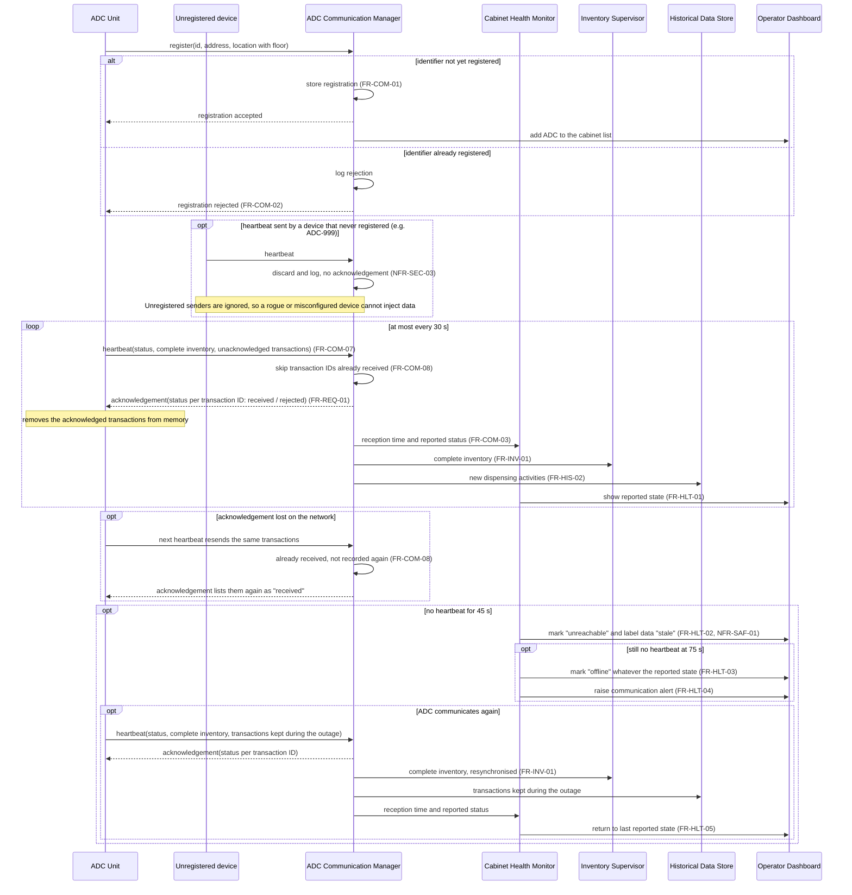
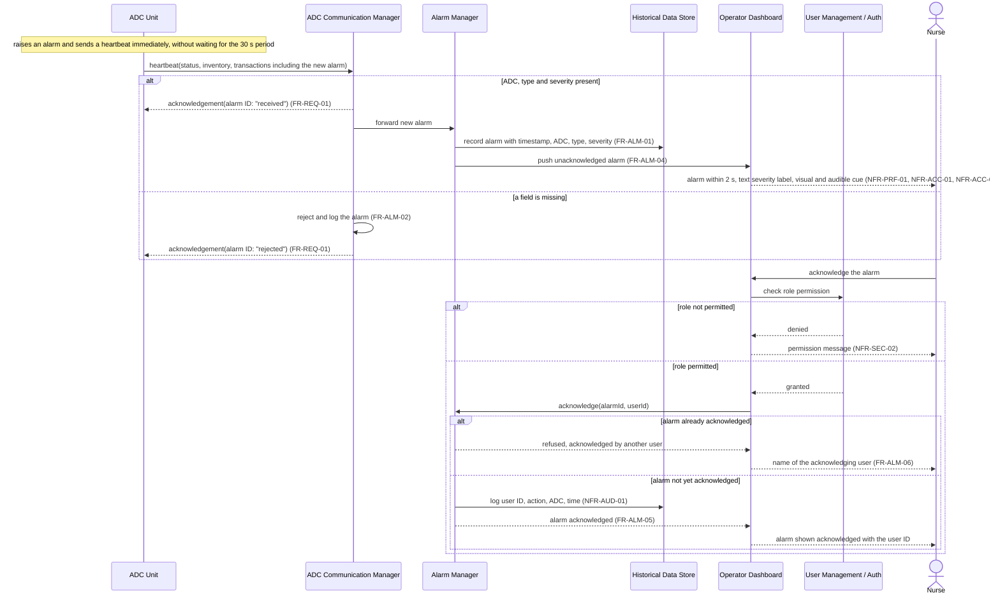
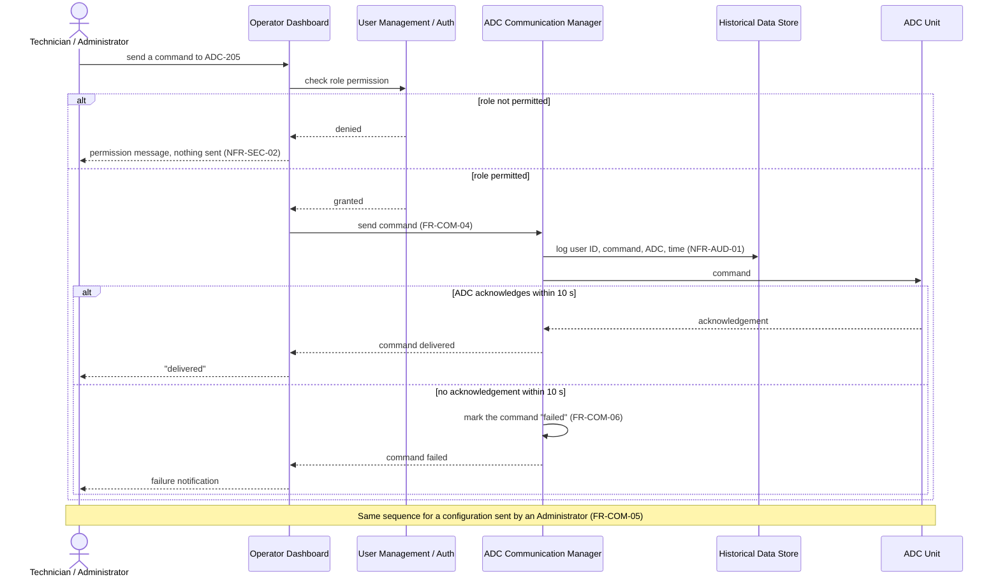

# Sequence Diagrams — Part B (Hospital Monitoring System)

## 1. ADC Registration and Heartbeat (Scenario 3)

## 2. Alarm Reception and Acknowledgement (Scenario 2)

## 3. Command or Configuration to an ADC

