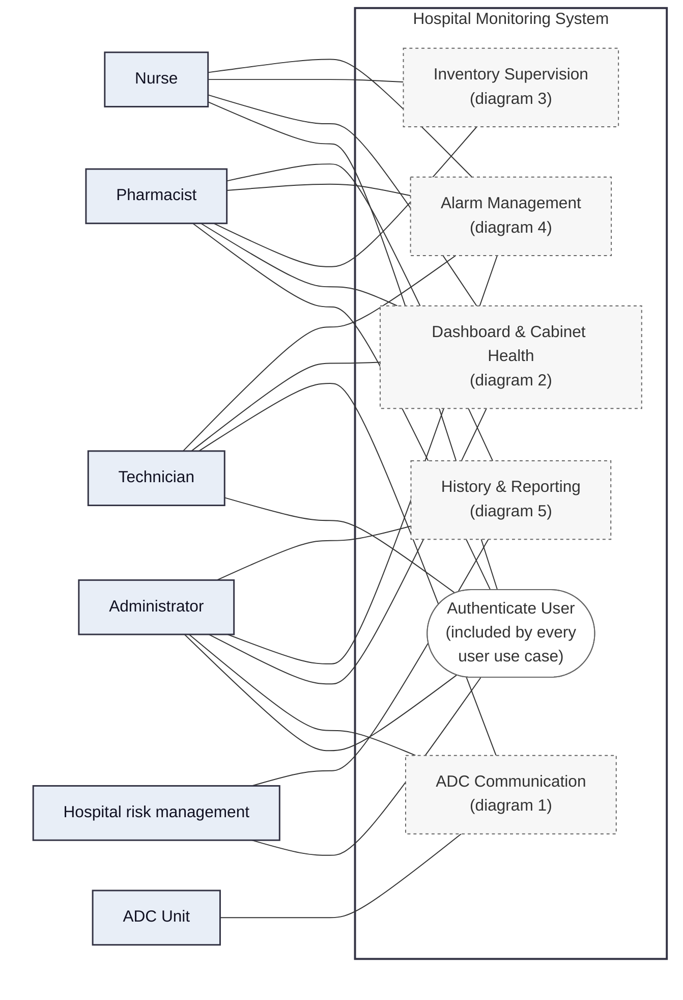
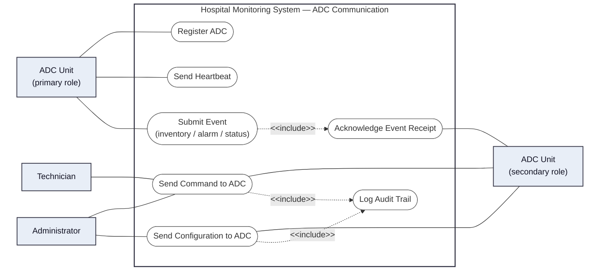
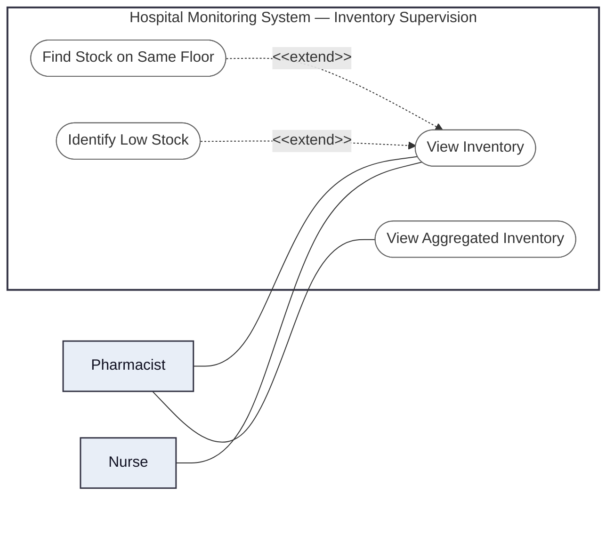
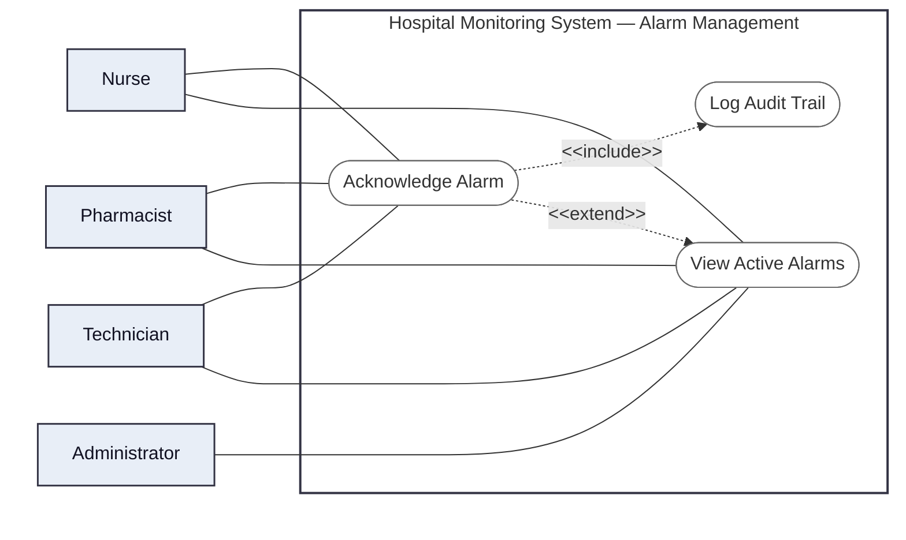
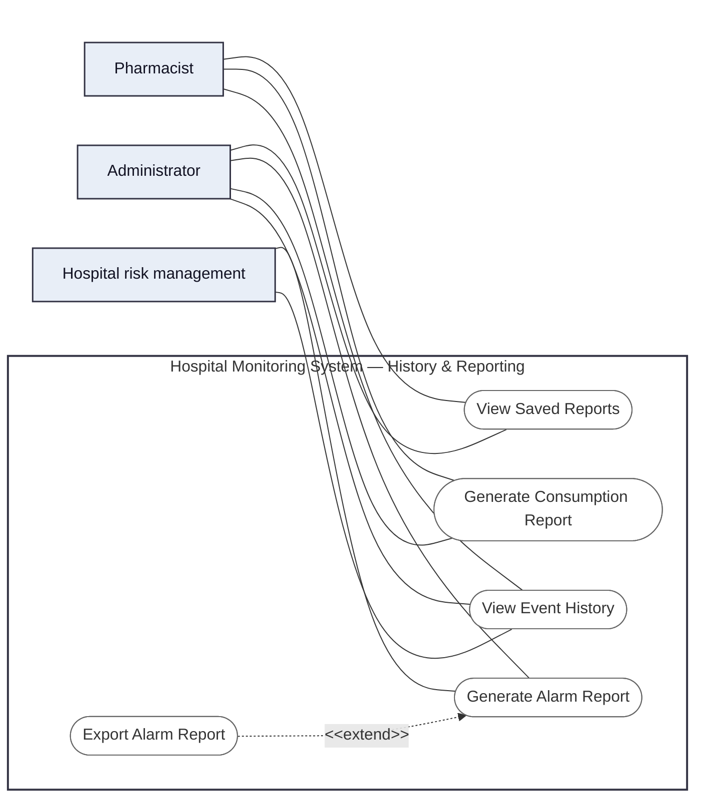

# Use Case Diagrams — Part B (Hospital Monitoring System)

## 0. Overview

## 1. ADC Communication

## 2. Dashboard & Cabinet Health

## 3. Inventory Supervision

## 4. Alarm Management

## 5. History & Reporting

