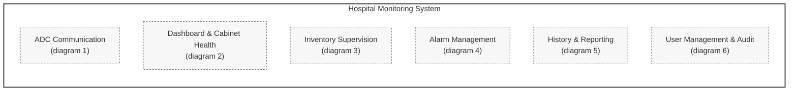
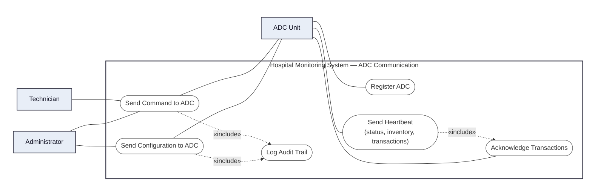
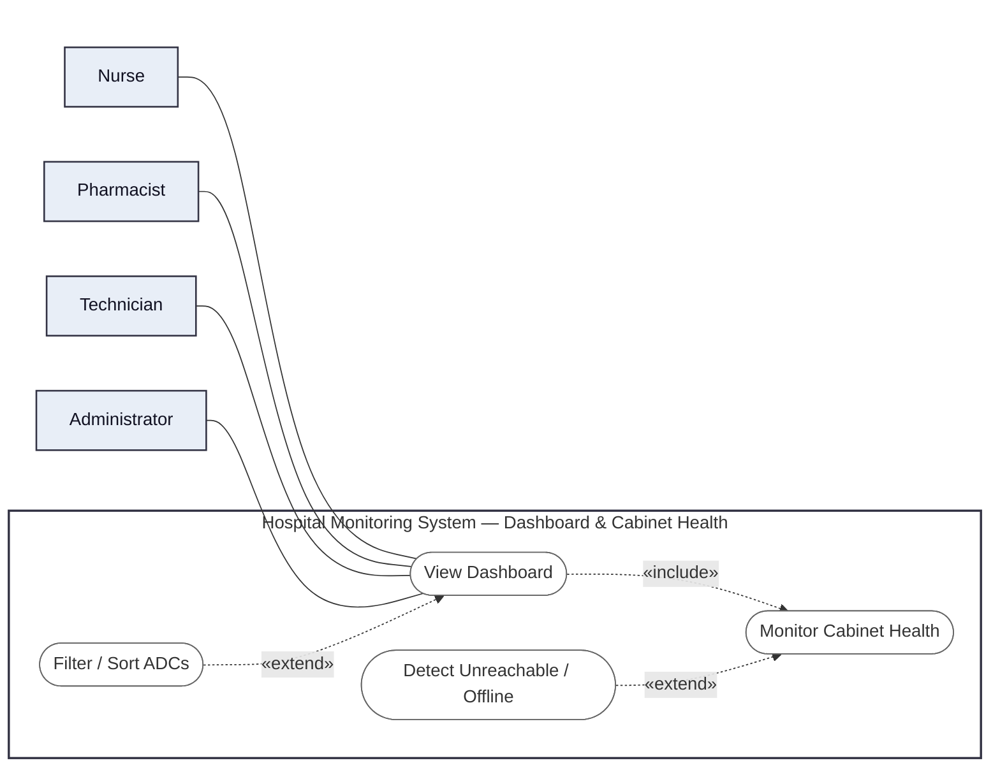
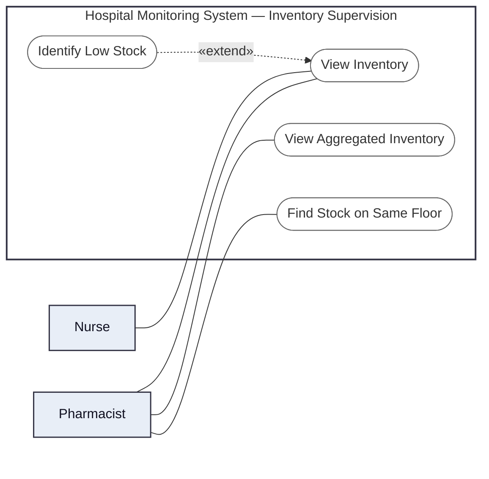
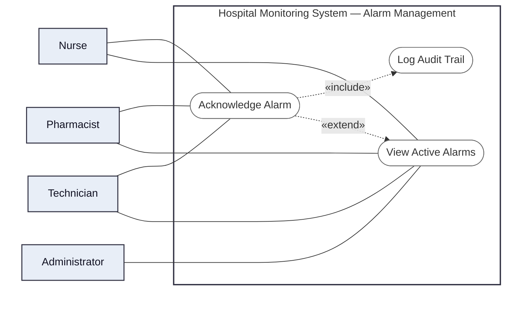
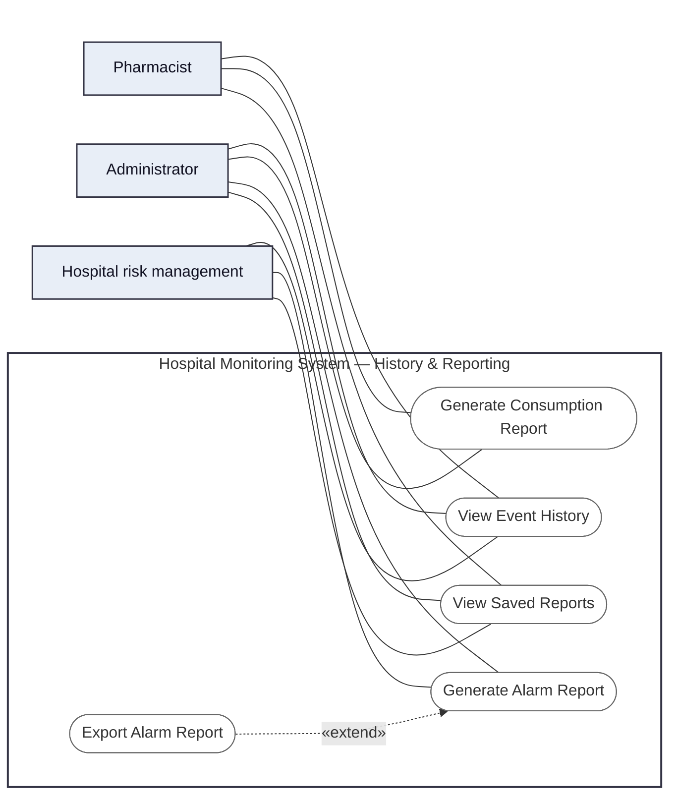
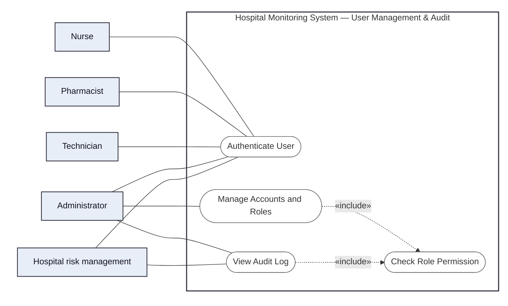

# Use Case Diagrams — Part B (Hospital Monitoring System)

## 0. Overview

The use cases are grouped into six packages, detailed in diagrams 1 to 6. Actors are linked to use cases only inside those diagrams; this table gives, for each package, the actors that take part in it.

| Package | Actors |
| --- | --- |
| ADC Communication | ADC Unit, Technician, Administrator |
| Dashboard & Cabinet Health | Nurse, Pharmacist, Technician, Administrator |
| Inventory Supervision | Nurse, Pharmacist |
| Alarm Management | Nurse, Pharmacist, Technician, Administrator |
| History & Reporting | Pharmacist, Administrator, Hospital risk management |
| User Management & Audit | all five user roles (authentication); Administrator, Hospital risk management (audit log) |

## 1. ADC Communication

## 2. Dashboard & Cabinet Health

## 3. Inventory Supervision

## 4. Alarm Management

## 5. History & Reporting

## 6. User Management & Audit

"Authenticate User" and "Check Role Permission" are included by every use case started by a user in diagrams 1 to 5 (all of them except "Register ADC", "Send Heartbeat" and "Acknowledge Transactions", which the ADC Unit starts); the «include» arrows are not repeated there to keep them readable.

## 7. User stories → use cases

| Story | Use case (diagram) |
| --- | --- |
| US-COM-01 | Register ADC (1) — started by the ADC Unit; the Administrator is the stakeholder who benefits |
| US-COM-02 | Send Command to ADC (1) |
| US-COM-03 | Send Configuration to ADC (1) |
| US-REQ-01 | Send Heartbeat, Acknowledge Transactions (1) |
| US-INV-01 | View Inventory (3) |
| US-INV-02 | Identify Low Stock (3) |
| US-INV-03 | Find Stock on Same Floor (3) |
| US-INV-04 | View Aggregated Inventory (3) |
| US-ALM-01 | View Active Alarms (4) |
| US-ALM-02 | Acknowledge Alarm (4) |
| US-HLT-01 | Monitor Cabinet Health (2) |
| US-HLT-02 | Detect Unreachable / Offline (2) |
| US-HLT-03 | Monitor Cabinet Health (2) |
| US-DSH-01 | View Dashboard (2) |
| US-DSH-02 | Filter / Sort ADCs (2) |
| US-HIS-01 | View Event History (5) |
| US-HIS-02 | View Event History (5), View Audit Log (6) |
| US-RPT-01 to US-RPT-05 | Generate Consumption Report (5) |
| US-RPT-06 | Generate Alarm Report, Export Alarm Report (5) |
| US-RPT-07 | View Saved Reports (5) |
| US-USR-01 | Authenticate User (6) |
| US-USR-02 | Check Role Permission (6) |
| US-USR-03 | Manage Accounts and Roles (6) |
