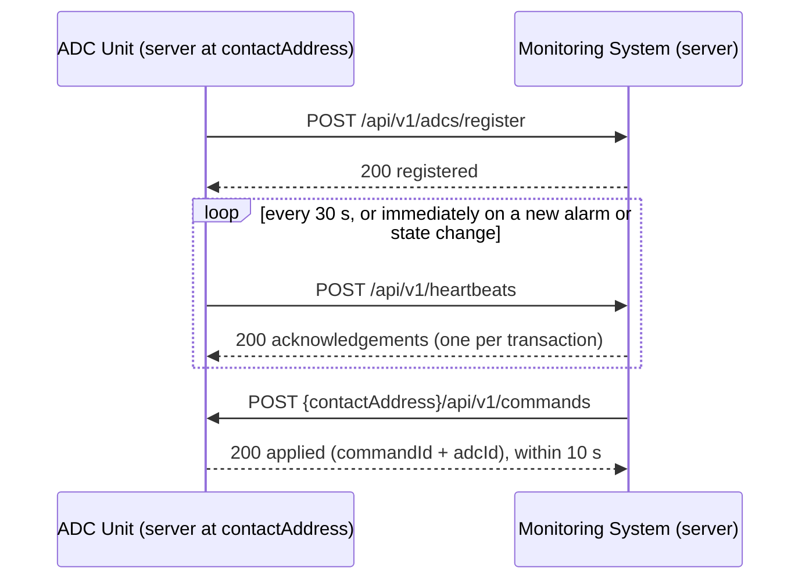

# ADC ↔ Monitoring System Interface Contract - Draft v0.1

## 1. Overview

| Topic         | Decision                                                                                             |
| ------------- | ---------------------------------------------------------------------------------------------------- |
| Transport     | HTTPS (NFR-SEC-05), request/response, JSON bodies encoded in UTF-8 (`Content-Type: application/json`) |
| Servers       | **Both sides expose an HTTP server**: the Monitoring System receives registrations and heartbeats; each ADC receives commands and configurations at the contact address it gave when registering |
| Data flow     | ADC → Monitoring: registration, heartbeats (push, every 30 s at most). Monitoring → ADC: commands and configurations (push) |
| Acknowledgement | Always the **synchronous HTTP response** to the request; there is no separate acknowledgement message |
| Versioning    | Every path starts with `/api/v1`; a breaking change moves to `/api/v2`                               |
| ADC identity  | The ADC puts its identifier in every message it sends (`adcId`); no other authentication in v1       |



## 2. Common formats

| Field kind      | Format                                                                                     | Example                                |
| --------------- | ------------------------------------------------------------------------------------------ | -------------------------------------- |
| Identifiers     | **Every identifier** is a UUID v4, lowercase: `adcId` (generated once by the ADC and kept across restarts), `transactionId`, `medicationId`, `patientId`, `staffMemberId`, `commandId`, `configurationId` | `"3f2c8a1e-9b4d-4c7a-8e21-5d0f6b9a1c34"` |
| Labels          | Non-empty strings, at most 128 characters, shown to users next to (or instead of) an identifier: `label` of an ADC, `medicationName`, `staffMemberName` | `"ADC West 214"` |
| Timestamps      | RFC 3339, **UTC**, with the `Z` suffix and milliseconds                                    | `"2026-10-16T14:03:27.512Z"`           |
| Quantities      | Integers, in boxes                                                                         | `12`                                   |
| Enumerations    | Lowercase snake_case strings (section 5)                                                    | `"maintenance"`                        |

Identifiers are what the systems compare, store and reference; labels are only displayed and may change (the latest one received wins). Patients have **no label**: a patient name would be health information crossing the interface for no requirement, so the patient stays known by its identifier only (PHIPA, NFR-SEC-04).

Both systems keep their clock synchronized with the hospital time server. Timestamps set by the ADC are stored as received (A-14); the Monitoring System never corrects them.

### Error body

Every 4xx/5xx response, on both sides, carries the same body:

```json
{
  "error": {
    "code": "INVALID_MESSAGE",
    "message": "Field 'inventory' is required.",
    "details": [{ "field": "inventory", "problem": "missing" }]
  }
}
```

`code` is taken from the tables of section 6; `message` is for humans and logs; `details` is optional.

## 3. Endpoints exposed by the Monitoring System

### 3.1 `POST /api/v1/adcs/register`

Sent by the ADC **at every start-up**, and whenever the Monitoring System answers `ADC_NOT_REGISTERED`.

Request:

```json
{
  "adcId": "c4a1e8f2-7b3d-4e9a-a5c6-2d8f0b1e3a47",
  "label": "ADC West 214",
  "contactAddress": "https://10.0.2.15:8443",
  "location": { "floor": 2, "description": "West wing, room 214" }
}
```

| Field                  | Type    | Required | Rule                                                             |
| ---------------------- | ------- | :------: | ---------------------------------------------------------------- |
| `adcId`                | string  | yes      | See section 2                                                    |
| `label`                | string  | yes      | Name of the ADC shown to users and used to sort the ADC list (FR-DSH-03) |
| `contactAddress`       | string  | yes      | Absolute `https://` base URL; the paths of section 4 are appended to it |
| `location.floor`       | integer | yes      | Floor number used by the same-floor stock search (FR-INV-04)     |
| `location.description` | string  | yes      | Free text shown to users                                         |

Response `200 OK`:

```json
{
  "adcId": "c4a1e8f2-7b3d-4e9a-a5c6-2d8f0b1e3a47",
  "registeredAt": "2026-10-16T14:00:00.000Z",
  "firstRegistration": true,
  "heartbeatPeriodSeconds": 30
}
```

**Re-registration**: a request whose `adcId` is already registered is **accepted**. It replaces the label, the contact address and the location, is written to the audit log, and answers `200` with `firstRegistration: false`. It changes neither the last heartbeat time, nor the connectivity status, nor the alarms of the ADC (a pending communication loss alarm stays unacknowledged, FR-HLT-07). The ADC sends its first heartbeat right after a successful registration.

Errors: `400 INVALID_MESSAGE`.

### 3.2 `POST /api/v1/heartbeats`

Request:

```json
{
  "adcId": "c4a1e8f2-7b3d-4e9a-a5c6-2d8f0b1e3a47",
  "sentAt": "2026-10-16T14:03:27.512Z",
  "state": "online",
  "inventory": [
    { "medicationId": "8c1d5e2a-4f3b-4a9e-b7d6-1e2f3a4b5c6d", "medicationName": "Morphine 10 mg/mL", "quantityInBoxes": 14 },
    { "medicationId": "b2e4f6a8-1c3d-4e5f-8a9b-0c1d2e3f4a5b", "medicationName": "Insulin glargine", "quantityInBoxes": 6 }
  ],
  "transactions": [
    {
      "type": "alarm",
      "transactionId": "3f2c8a1e-9b4d-4c7a-8e21-5d0f6b9a1c34",
      "timestamp": "2026-10-16T14:03:27.100Z",
      "alarmType": "temperature_out_of_range",
      "severity": "critical",
      "description": "Drawer 3 at 11.2 °C"
    },
    {
      "type": "dispensing",
      "transactionId": "a7b8c9d0-e1f2-4a3b-9c4d-5e6f7a8b9c0d",
      "timestamp": "2026-10-16T14:01:02.000Z",
      "medicationId": "8c1d5e2a-4f3b-4a9e-b7d6-1e2f3a4b5c6d",
      "medicationName": "Morphine 10 mg/mL",
      "quantityInBoxes": 1,
      "patientId": "6b0f3c2e-8d1a-4f7b-9e5c-3a2d1f0e9b8c",
      "staffMemberId": "e9d8c7b6-a5f4-4e3d-8c2b-1a0f9e8d7c6b",
      "staffMemberName": "Jane Doe, RN"
    }
  ]
}
```

**Envelope** (the whole heartbeat is refused with `400` if one of these is missing or invalid):

| Field          | Type   | Rule                                                                                       |
| -------------- | ------ | ------------------------------------------------------------------------------------------ |
| `adcId`        | string | Identifies the sender, and the originating ADC of every transaction it contains (FR-COM-09, FR-ALM-02) |
| `sentAt`       | string | Timestamp set by the ADC when sending                                                      |
| `state`        | string | `online`, `maintenance` or `fault` (FR-HLT-01)                                             |
| `inventory`    | array  | **Complete** inventory (FR-INV-01, NFR-REL-03); may be empty; one entry per medication     |
| `inventory[].medicationId`    | string  | UUID v4                                                                     |
| `inventory[].medicationName`  | string  | Name shown to users; the Monitoring System learns the medication list from inventories |
| `inventory[].quantityInBoxes` | integer | ≥ 0                                                                         |
| `transactions` | array  | Every transaction not yet acknowledged "received" or "rejected"; may be empty              |

**Transactions** (an invalid transaction is rejected on its own, the rest of the heartbeat is still processed):

| `type`       | Required fields                                                                                    | Optional      |
| ------------ | -------------------------------------------------------------------------------------------------- | ------------- |
| `alarm`      | `transactionId`, `timestamp`, `alarmType` (section 5.2), `severity` (section 5.3)                  | `description` |
| `dispensing` | `transactionId`, `timestamp`, `medicationId`, `medicationName`, `quantityInBoxes` (≥ 1), `patientId`, `staffMemberId`, `staffMemberName` | –             |

Response `200 OK`, sent **only after** the received transactions have been recorded (FR-REQ-01):

```json
{
  "receivedAt": "2026-10-16T14:03:27.640Z",
  "acknowledgements": [
    { "transactionId": "3f2c8a1e-9b4d-4c7a-8e21-5d0f6b9a1c34", "status": "received" },
    { "transactionId": "a7b8c9d0-e1f2-4a3b-9c4d-5e6f7a8b9c0d", "status": "rejected", "reason": "MISSING_FIELD", "field": "staffMemberId" }
  ]
}
```

- One acknowledgement per transaction of the request, in the same order.
- `received`: recorded now, **or already recorded by an earlier heartbeat** (duplicate, not recorded again: FR-COM-08, D-07).
- `rejected`: will never be recorded; `reason` comes from section 6.3. A transaction without a usable `transactionId` cannot be acknowledged: the whole heartbeat is refused with `400` instead.
- In both cases the ADC removes the transaction from its memory.

Errors: `400 INVALID_MESSAGE` (envelope), `404 ADC_NOT_REGISTERED` (NFR-SEC-03: discarded and logged; the ADC must register again, then resend), `5xx` (section 7). A heartbeat answered with an error is **not** a heartbeat for the connectivity status: its reception time is not recorded (FR-COM-03).

## 4. Endpoints exposed by each ADC

Paths are relative to the `contactAddress` given at registration. The Monitoring System waits **10 seconds** at most for the response (FR-COM-06); no response in time, a connection error or any non-`200` response marks the command or configuration as "failed" and notifies the sender.

### 4.1 `POST {contactAddress}/api/v1/commands`

Version 1 defines a single command: `set_maintenance_mode`.

Request:

```json
{
  "commandId": "5d6e7f80-91a2-4b3c-8d4e-5f6a7b8c9d0e",
  "adcId": "c4a1e8f2-7b3d-4e9a-a5c6-2d8f0b1e3a47",
  "command": "set_maintenance_mode",
  "parameters": { "enabled": true },
  "issuedAt": "2026-10-16T14:10:00.000Z"
}
```

Response `200 OK` = acknowledgement:

```json
{ "commandId": "5d6e7f80-91a2-4b3c-8d4e-5f6a7b8c9d0e", "adcId": "c4a1e8f2-7b3d-4e9a-a5c6-2d8f0b1e3a47", "status": "applied" }
```

- The command is "delivered" only if `commandId` **and** `adcId` match the request (FR-COM-11); otherwise it is "failed".
- `enabled: true` puts the ADC in maintenance, `false` brings it back online. Applying the state the ADC is already in is not an error.
- A `commandId` received twice is acknowledged again without being applied twice.
- After a state change, the ADC sends a heartbeat immediately, so that the dashboard shows the new state without waiting for the 30-second period.

Errors: `400 INVALID_MESSAGE`, `400 UNKNOWN_COMMAND`, `409 ADC_ID_MISMATCH` (the address now belongs to another ADC), `409 COMMAND_NOT_APPLICABLE` (the ADC cannot apply it now, e.g. in `fault`).

### 4.2 `POST {contactAddress}/api/v1/configuration`

Request (partial update: only the listed settings change; the whole configuration is applied or none of it). The label of the ADC is not a setting: it belongs to the ADC and is sent at registration.

```json
{
  "configurationId": "0e1f2a3b-4c5d-4e6f-9a7b-8c9d0e1f2a3b",
  "adcId": "c4a1e8f2-7b3d-4e9a-a5c6-2d8f0b1e3a47",
  "settings": {
    "timeServer": "ntp.hospital.local",
    "screenLockTimeoutSeconds": 60
  },
  "issuedAt": "2026-10-16T14:12:00.000Z"
}
```

| Setting                    | Type    | Rule        | Purpose                                             |
| -------------------------- | ------- | ----------- | --------------------------------------------------- |
| `timeServer`               | string  | host name   | Time server the ADC synchronizes with (timestamps, A-14) |
| `screenLockTimeoutSeconds` | integer | 15–600      | Inactivity delay before the ADC locks its screen    |

Response `200 OK`:

```json
{ "configurationId": "0e1f2a3b-4c5d-4e6f-9a7b-8c9d0e1f2a3b", "adcId": "c4a1e8f2-7b3d-4e9a-a5c6-2d8f0b1e3a47", "status": "applied" }
```

Same delivery rule as commands (both identifiers must match). Errors: `400 INVALID_MESSAGE`, `400 UNKNOWN_SETTING`, `400 INVALID_SETTING_VALUE`, `409 ADC_ID_MISMATCH`.

## 5. Shared enumerations

### 5.1 `state` (reported by the ADC)

`online`, `maintenance`, `fault`.

### 5.2 `alarmType`

| Value                      | Meaning                                         |
| -------------------------- | ----------------------------------------------- |
| `temperature_out_of_range` | Storage temperature outside its allowed range   |
| `unauthorized_access`      | Access attempt refused, or drawer forced        |
| `door_left_open`           | Door or drawer open longer than allowed         |
| `dispensing_failure`       | Mechanism jam or wrong quantity dispensed       |
| `power_failure`            | Mains lost, ADC running on battery              |
| `hardware_fault`           | Any other internal failure                      |
| `other`                    | Anything else; `description` should explain it  |

`communication_loss` is reserved to the Monitoring System (FR-HLT-04) and rejected if an ADC sends it. Any other unknown `alarmType` is **accepted** and shown as is: an alarm must not be lost because the two teams' lists drifted apart. An unknown `severity`, in contrast, is rejected (FR-ALM-03, D-08), since it drives how the alarm is handled.

### 5.3 `severity`

`info`, `warning`, `error`, `critical` (FR-ALM-03).

### 5.4 `command`

`set_maintenance_mode`.

## 6. Error codes

### 6.1 Returned by the Monitoring System

| HTTP | `code`               | When                                                   | ADC reaction                                  |
| ---- | -------------------- | ------------------------------------------------------ | --------------------------------------------- |
| 400  | `INVALID_MESSAGE`    | Invalid JSON, or missing/invalid envelope field        | Log it; keep the transactions; next period    |
| 404  | `ADC_NOT_REGISTERED` | Heartbeat from an unknown `adcId`                      | Register again, then send a heartbeat         |
| 500  | `INTERNAL_ERROR`     | Unexpected failure; nothing was acknowledged           | Keep the transactions; next period            |
| 503  | `UNAVAILABLE`        | Monitoring System starting or overloaded               | Keep the transactions; next period            |

### 6.2 Returned by an ADC

| HTTP | `code`                   | When                                                  |
| ---- | ------------------------ | ----------------------------------------------------- |
| 400  | `INVALID_MESSAGE`        | Invalid JSON or missing field                         |
| 400  | `UNKNOWN_COMMAND`        | `command` not in section 5.4                          |
| 400  | `UNKNOWN_SETTING`        | A key of `settings` not in section 4.2                |
| 400  | `INVALID_SETTING_VALUE`  | A setting outside its rule                            |
| 409  | `ADC_ID_MISMATCH`        | `adcId` of the request is not this ADC                |
| 409  | `COMMAND_NOT_APPLICABLE` | The command cannot be applied in the current state    |
| 500  | `INTERNAL_ERROR`         | Unexpected failure                                    |

The Monitoring System shows the `code` and `message` to the sender of a failed command or configuration.

### 6.3 Rejection reasons of a transaction (`acknowledgements[].reason`)

| `reason`            | When                                                             | Requirement          |
| ------------------- | ---------------------------------------------------------------- | -------------------- |
| `MISSING_FIELD`     | A required field is absent or empty (`field` names it)           | FR-ALM-02, FR-COM-10 |
| `INVALID_SEVERITY`  | `severity` not in section 5.3                                    | FR-ALM-03            |
| `INVALID_VALUE`     | Wrong type or format (bad UUID, bad timestamp, quantity < 1, reserved `communication_loss`) | D-08 |
| `UNKNOWN_TYPE`      | `type` is neither `alarm` nor `dispensing`                       | –                    |

## 7. Unavailability and retries

| Situation                                              | Behaviour                                                                                                     |
| ------------------------------------------------------ | ------------------------------------------------------------------------------------------------------------- |
| Monitoring System down, timeout (10 s) or `5xx`        | The ADC keeps every transaction and tries again **at the heartbeat rhythm** (30 s), with no faster retries. A new alarm still triggers an immediate heartbeat (A-08). |
| Response to a heartbeat lost on the network            | The next heartbeat resends the same transactions; they are acknowledged "received" again without being recorded twice (D-07). |
| Two heartbeats in flight                               | The ADC sends at most one heartbeat at a time; it waits for the response (or the 10 s timeout) before the next one. |
| ADC restarts                                           | It registers again with the same `adcId` (accepted, section 3.1), then resumes heartbeats with the transactions it kept. |
| Monitoring System lost its registrations               | Heartbeats get `404 ADC_NOT_REGISTERED`; each ADC registers again by itself.                                  |
| ADC "unreachable" (45 s without heartbeat)             | Commands and configurations are still attempted; the 10 s timeout applies.                                    |
| ADC "offline" (75 s without heartbeat)                 | Nothing is sent; the user is told the request is refused (FR-COM-12).                                         |
| No response from the ADC within 10 s                   | "failed", sender notified (FR-COM-06); no automatic retry: the user decides whether to send again (D-04).     |
| ADC memory full during a long outage                   | Out of scope: the ADC memory is assumed large enough for any outage (closes O-03).                            |

## 8. Resolution of the open points

| ID   | Resolution                                                                                           |
| ---- | ---------------------------------------------------------------------------------------------------- |
| O-01 | Formats fixed by sections 2 to 6; summarized in the requirements document by A-18, A-20, A-21 |
| O-02 | Agreed: one acknowledgement per transaction with `received` / `rejected` (section 3.2): A-19      |
| O-03 | Agreed: memory saturation is assumed not to happen: A-24                                          |
| O-04 | Agreed: immediate heartbeat when an alarm is raised, extended to state changes (section 4.1): A-08 |

Re-registration with the same identifier (section 3.1) is recorded as A-22 and D-20, and changes FR-COM-02; the retry rhythm (section 7) is A-23.
